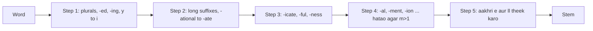

**In simple words:** stemming word ka ending kaat deta hai, taaki *connect, connected, connecting, connection* sab ek stem *connect* ban jaayen. Porter stemmer (Martin Porter, 1980) suffix rules ki chhoti list ko paanch steps mein lagata hai, aur dictionary nahi chahiye. <Cite id="text-preprocessing-porter1980" /> <Cite id="porter-stemmer-gfg-stemming" />

**Kyun zaroori hai:** *connect* search karne par *connected* aur *connections* bhi milne chahiye, aur ek stem se vocabulary chhoti ho jaati hai. Stem real word ho, ye zaroori nahi (*happy* se *happi* banta hai). <Cite id="porter-stemmer-def" loc="§1" />

**Main idea.** Lambe endings dheere-dheere kai steps mein hataye jaate hain. Rule ka form hai (condition) S1 to S2: agar word S1 pe khatam hota hai aur uske pehle ka hissa condition pass karta hai, to S1 ko S2 se badlo. Condition aksar **measure m** use karti hai, yaani stem mein vowel-consonant groups ki ginti (*tree* m=0, *trouble* m=1, *private* m=2). Isse galat cuts rukte hain: *activate* se *-ate* hat jaata hai par *rate* se nahi. Kai rules fit hon to sabse lamba suffix jeetta hai. <Cite id="porter-stemmer-def" loc="§2" />

<Cite id="porter-stemmer-def" loc="steps" />

<Sum>

<Given>

words *caresses, ponies, motoring, hopping, happy, relational*.

</Given>

<Find>

har word ka Porter stem, step by step.

</Find>

<Steps>

1. **caresses.** Step 1a: SSES to SS se *caress*. Aur kuch lagu nahi hota.
2. **ponies.** Step 1a: IES to I se *poni*.
3. **motoring.** Step 1b: ING hat jaata hai kyunki *motor* mein vowel hai. Result *motor*.
4. **hopping.** Step 1b: ING hatao to *hopp*. Clean-up: double consonant (l, s, z ke alawa) single ho jaata hai, to *hop*.
5. **happy.** Step 1c: Y ko I banao kyunki *happ* mein vowel hai. Result *happi*.
6. **relational.** Step 2: ATIONAL to ATE kyunki *rel* ka $m=1>0$, to *relate*. Step 4 ATE nahi hata sakta (*rel* ka $m$ 1 hai, 1 se zyada nahi). Step 5a: *relat* ka $m=2>1$, to aakhri E hat jaata hai. Result *relat*. *Reason: har rule ko apni measure condition chahiye.*

</Steps>

<Answer>

caress, poni, motor, hop, happi, relat.

</Answer>

<Box kind="verify">

NLTK ke original-algorithm Porter stemmer se dobara nikala: chhahon match karte hain. Pehle paanch rules aur *relational* ka step 2 change Porter ke paper ke examples mein bhi hain. *relat* ki ginti: r-e-l-a-t C V C V C hai, to $m=2$. Dhyan rahe *happi* aur *relat* real words nahi hain, jo expected hai.

</Box>

</Sum>

**Advantages:** fast, simple, dictionary nahi chahiye, search ke liye achha. **Disadvantages:** over-stemming (*university* aur *universe* dono *univers* ban jaate hain), under-stemming (*alumni* aur *alumnus* alag rehte hain), sirf English. <Cite id="porter-stemmer-nltk-stem" />

**Conclusion:** Porter stemmer paanch conditional steps mein suffix hata kar common stem deta hai.
