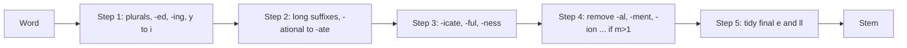

**In simple words:** stemming cuts the ending off a word so that *connect, connected, connecting, connection* all become one stem, *connect*. The Porter stemmer (Martin Porter, 1980) does this with a short list of suffix rules applied in five steps, and it needs no dictionary. <Cite id="text-preprocessing-porter1980" /> <Cite id="porter-stemmer-gfg-stemming" />

**Why it is needed:** a search for *connect* should also find *connected* and *connections*, and one stem makes the vocabulary smaller. The stem need not be a real word (*happy* becomes *happi*). <Cite id="porter-stemmer-def" loc="§1" />

**Main idea.** Long endings are removed bit by bit over several steps. A rule is written as (condition) S1 to S2: if the word ends in S1 and the part before it passes the condition, replace S1 by S2. The condition often uses the **measure m**, the number of vowel-consonant groups in the stem (*tree* m=0, *trouble* m=1, *private* m=2). This stops silly cuts: *-ate* goes from *activate* but not from *rate*. When several rules fit, the longest suffix wins. <Cite id="porter-stemmer-def" loc="§2" />

<Cite id="porter-stemmer-def" loc="steps" />

<Sum>

<Given>

the words *caresses, ponies, motoring, hopping, happy, relational*.

</Given>

<Find>

the Porter stem of each word, step by step.

</Find>

<Steps>

1. **caresses.** Step 1a: SSES to SS gives *caress*. Nothing else applies.
2. **ponies.** Step 1a: IES to I gives *poni*.
3. **motoring.** Step 1b: ING is removed because *motor* has a vowel. Result *motor*.
4. **hopping.** Step 1b: remove ING to get *hopp*. Clean-up: a double consonant (not l, s, z) becomes single, so *hop*.
5. **happy.** Step 1c: Y becomes I because *happ* has a vowel. Result *happi*.
6. **relational.** Step 2: ATIONAL to ATE since *rel* has $m=1>0$, giving *relate*. Step 4 cannot drop ATE ($m$ of *rel* is 1, not above 1). Step 5a: *relat* has $m=2>1$, so the final E goes. Result *relat*. *Reason: each rule needs its measure condition.*

</Steps>

<Answer>

caress, poni, motor, hop, happi, relat.

</Answer>

<Box kind="verify">

Recomputed with NLTK's original-algorithm Porter stemmer: all six match. The first five rules and the step 2 change for *relational* also appear as examples in Porter's paper. Count of *relat*: r-e-l-a-t is C V C V C, so $m=2$. Note that *happi* and *relat* are not real words, which is expected.

</Box>

</Sum>

**Advantages:** fast, simple, no dictionary, good for search. **Disadvantages:** over-stemming (*university* and *universe* both give *univers*), under-stemming (*alumni* and *alumnus* stay apart), English only. <Cite id="porter-stemmer-nltk-stem" />

**Conclusion:** Porter's stemmer strips suffixes in five conditional steps to give a common stem.
