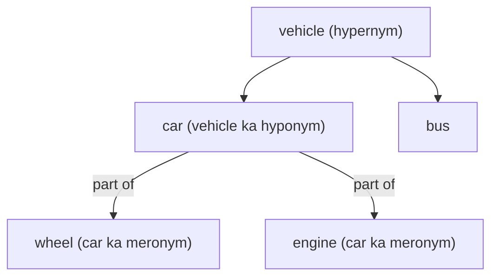

**In simple words:** words apne meanings ke hisaab se ek-doosre se jude hote hain. Kuch words ki spelling same hoti hai par meaning nahi, kuch ke meanings related hote hain, kuch same ya opposite meaning dete hain, kuch "ek kism ka" ya "ek hissa" hote hain. WordNet yahi links store karta hai. <Cite id="lexical-semantics-slp3-appH" /> <Cite id="lexical-semantics-gfg-semantic" />

**1. Homonymy.** Spelling (aur aksar sound) same, par meanings **unrelated**. *Bank* = paise ki jagah / nadi ka kinara. *Bat* = cricket bat / udne wala jaanwar. <Cite id="lexical-semantics-wiki-homonym" />

**2. Polysemy.** Ek word ke kai **related** meanings. Insaan ka *mouth* aur nadi ka *mouth* (dono ek opening); *bank* building aur *bank* organisation. Test: agar koi shared idea dikhe to polysemy, nahi to homonymy. <Cite id="ambiguity-challenges-wiki-polysemy" />

**3. Synonymy.** Alag words, (lagbhag) same meaning: *big* aur *large*, *couch* aur *sofa*. Pure synonyms kam hote hain kyunki words tone ya use mein alag hote hain (*water* aur *H2O*).

**4. Antonymy.** **Opposite** meaning wale words: *hot* / *cold*, *up* / *down*, *buy* / *sell*.

**5. Hypernymy.** **General** word jo kisi specific word ko cover karta hai: *vehicle*, *car* ka hypernym hai; *fruit*, *mango* ka.

**6. Hyponymy.** **Specific** word, general ka ek kism: *car*, *vehicle* ka hyponym hai; *mango*, *fruit* ka. Hyponym aur hypernym ek hi "is-a" link ke do sire hain. <Cite id="lexical-semantics-wiki-hyponymy" />

**7. Meronymy.** "**Part of**" link: *wheel*, *car* ka meronym hai; *finger*, *hand* ka. Poora (*car*) holonym kehlata hai. <Cite id="lexical-semantics-wiki-meronymy" />

<Cite id="lexical-semantics-gfg-semantic" loc="diagram" />

| Relation | Words ke beech link | Example |
|---|---|---|
| Homonymy | same form, unrelated meanings | bank (river) / bank (money) |
| Polysemy | same form, related meanings | insaan / nadi ka mouth |
| Synonymy | same meaning | big, large |
| Antonymy | opposite meaning | hot, cold |
| Hypernymy | general term | vehicle |
| Hyponymy | specific term | car |
| Meronymy | whole ka hissa | car ka wheel |

**Use:** ye links word sense disambiguation, search (synonyms se query expansion) aur question answering mein kaam aate hain.

**Conclusion:** word meanings same, opposite, general-specific aur part-whole links ka network banate hain.
