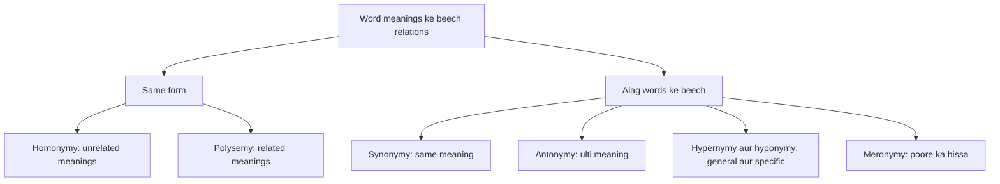
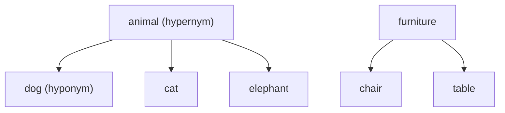

**In simple words:** words ki meanings kuch regular tareeqon se ek doosre se judi hoti hain. In links ko jaanne se computer samajh pata hai ki *dog* ek tarah ka *animal* hai aur *bank* ke do alag matlab ho sakte hain. Inhe lexical relations kehte hain: language ke words (lexemes) ke beech ke semantic aur formal connections. <Cite id="class-nlp-pyq4" loc="p. 10" />

1. **Homonymy:** ek hi word form (spelling, sound, ya dono) ki do ya zyaada bilkul unrelated meanings hoti hain. *Example:* bank (financial institution) versus bank (nadi ka kinara). <Cite id="class-nlp-pyq4" loc="p. 2" />

2. **Polysemy:** ek hi lexeme ki kai meanings hoti hain jo logically ya historically ek doosre se related hain. *Example:* word *head* ka matlab body ka hissa, ya incharge person (head of school), ya page ya table ka top ho sakta hai. <Cite id="class-nlp-pyq4" loc="p. 2" />

3. **Synonymy:** do ya zyaada lexemes ki meaning milti-julti ya lagbhag same hoti hai. Sachche absolute synonyms (har context mein badle ja sakne wale) kam hote hain kyunki tone ya connotation mein chhota farak hota hai. *Example:* smart aur intelligent; big aur large. <Cite id="class-nlp-pyq4" loc="p. 1" />

4. **Antonymy:** wo lexemes jinki meaning ulti hoti hai. Ye aam taur par teen sub-types mein baanta jaata hai: <Cite id="class-nlp-pyq4" loc="p. 1" />
   - **Gradable antonyms:** ek continuous spectrum par opposites jinki comparison ho sakti hai, jaise hot aur cold (cheez garm ya thandi ho sakti hai).
   - **Complementary antonyms:** binary opposites jinke beech kuch nahi hota, ek doosre ko exclude karta hai, jaise alive aur dead.
   - **Relational antonyms:** opposites jo ek hi reciprocal relationship ko ulte sides se batate hain, jaise buy aur sell, ya teacher aur student.

5. **Hypernymy:** hyponymy ka ulta. Ek general, broader lexeme specific lexemes ki meaning ko cover karta hai; upar wala term hypernym ("superordinate" term) kehlata hai. *Example:* animal, dog, cat aur elephant ka hypernym hai; furniture, chair aur table ka hypernym hai. <Cite id="class-nlp-pyq4" loc="p. 2" />

6. **Hyponymy:** ek hierarchical ("inclusion") relationship jisme ek specific lexeme ki meaning ek zyaada general lexeme ki meaning ke andar aati hai. General term hypernym hai aur specific term hyponym. *Example:* dog, animal ka hyponym hai, aur rose, flower ka hyponym. <Cite id="class-nlp-pyq4" loc="p. 1" />

7. **Meronymy:** lexemes ke beech part-whole relationship: ek word us object ka ek hissa batata hai jo doosra word batata hai. *Example:* wheel, car ka meronym hai; page, book ka meronym hai. <Cite id="class-nlp-pyq4" loc="p. 1" />

| Relation | Idea | Example |
|---|---|---|
| Homonymy | Same form, unrelated meanings | bank (money) aur bank (river) |
| Polysemy | Ek word, related meanings | head (body, boss, page ka top) |
| Synonymy | Same ya bahut close meaning | smart aur intelligent |
| Antonymy | Ulti meaning | hot aur cold; buy aur sell |
| Hypernymy | Upar ka general word | dog ke upar animal |
| Hyponymy | Neeche ka specific word | animal ke neeche dog |
| Meronymy | Poore ka hissa | car ka wheel |

**Homonymy versus polysemy:** homonymy mein meanings unrelated hoti hain; polysemy mein related.

**Conclusion:** ye relations language ke words ko organize karti hain, jinhe lexicon record karta hai.
