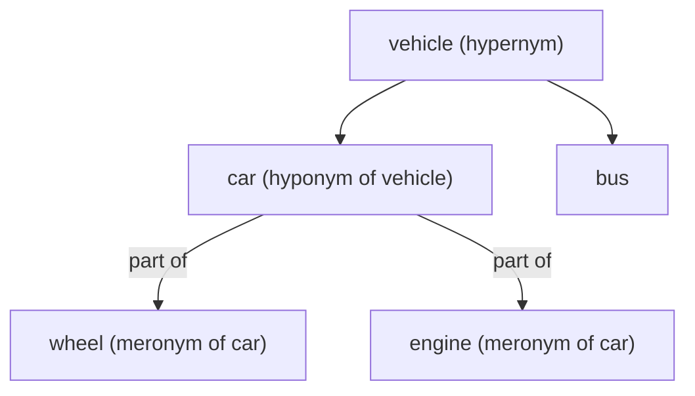

**In simple words:** words are linked to each other by their meanings. Some words share a spelling but not a meaning, some have related meanings, some mean the same, opposite, or are "a kind of" or "a part of" another word. WordNet stores exactly these links. <Cite id="lexical-semantics-slp3-appH" /> <Cite id="lexical-semantics-gfg-semantic" />

**1. Homonymy.** Same spelling (and often sound), **unrelated** meanings. *Bank* = money place / river side. *Bat* = cricket bat / flying animal. <Cite id="lexical-semantics-wiki-homonym" />

**2. Polysemy.** One word with several **related** meanings. *Mouth* of a person and *mouth* of a river (both an opening); *bank* the building and *bank* the organisation. Test: if you can see a shared idea, it is polysemy; if not, homonymy. <Cite id="ambiguity-challenges-wiki-polysemy" />

**3. Synonymy.** Different words, (nearly) the same meaning: *big* and *large*, *couch* and *sofa*. True synonyms are rare because words differ in tone or use (*water* and *H2O*).

**4. Antonymy.** Words with **opposite** meanings: *hot* / *cold*, *up* / *down*, *buy* / *sell*.

**5. Hypernymy.** The **general** word that covers a more specific one: *vehicle* is a hypernym of *car*; *fruit* of *mango*.

**6. Hyponymy.** The **specific** word, a kind of the general one: *car* is a hyponym of *vehicle*; *mango* of *fruit*. Hyponym and hypernym are the two ends of the same "is-a" link. <Cite id="lexical-semantics-wiki-hyponymy" />

**7. Meronymy.** The "**part of**" link: *wheel* is a meronym of *car*; *finger* of *hand*. The whole (*car*) is the holonym. <Cite id="lexical-semantics-wiki-meronymy" />

<Cite id="lexical-semantics-gfg-semantic" loc="diagram" />

| Relation | Link between words | Example |
|---|---|---|
| Homonymy | same form, unrelated meanings | bank (river) / bank (money) |
| Polysemy | same form, related meanings | mouth of a person / river |
| Synonymy | same meaning | big, large |
| Antonymy | opposite meaning | hot, cold |
| Hypernymy | general term | vehicle |
| Hyponymy | specific term | car |
| Meronymy | part of a whole | wheel of a car |

**Use:** these links help word sense disambiguation, search (query expansion with synonyms) and question answering.

**Conclusion:** word meanings form a network of same, opposite, general-specific and part-whole links.
