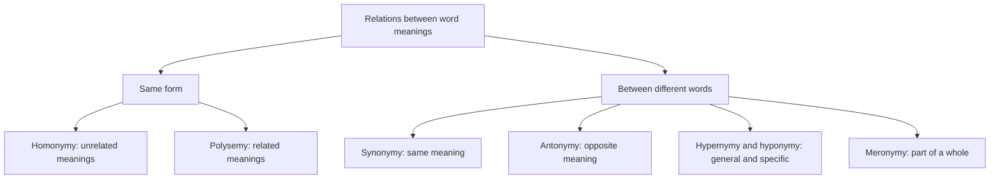
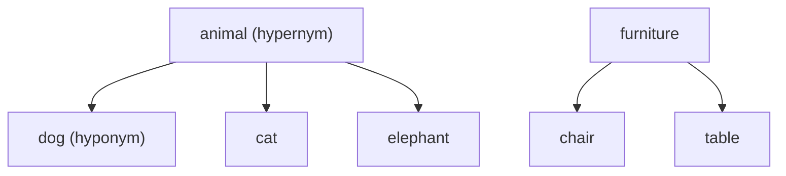

**In simple words:** the meanings of words are linked to each other in a few regular ways. Knowing these links helps a computer see that *dog* is a kind of *animal* and that *bank* can mean two different things. These links are called lexical relations: the semantic and formal connections that hold between words (lexemes) in a language. <Cite id="class-nlp-pyq4" loc="p. 10" />

1. **Homonymy:** a single word form (spelling, sound, or both) has two or more completely unrelated meanings. *Example:* bank (financial institution) versus bank (river side). <Cite id="class-nlp-pyq4" loc="p. 2" />

2. **Polysemy:** a single lexeme has multiple meanings that are logically or historically related to one another. *Example:* the word *head* can mean the part of the body, a person in charge (head of school), or the top of a page or table. <Cite id="class-nlp-pyq4" loc="p. 2" />

3. **Synonymy:** two or more lexemes share very similar or nearly identical meanings. True absolute synonyms (interchangeable in every context) are rare because of subtle differences in tone or connotation. *Example:* smart and intelligent; big and large. <Cite id="class-nlp-pyq4" loc="p. 1" />

4. **Antonymy:** lexemes that have opposite meanings. It is typically split into three sub-types: <Cite id="class-nlp-pyq4" loc="p. 1" />
   - **Gradable antonyms:** opposites on a continuous spectrum that allow comparison, for example hot and cold (something can be warmer or cooler).
   - **Complementary antonyms:** binary opposites with no middle ground, where one excludes the other, for example alive and dead.
   - **Relational antonyms:** opposites that describe the same reciprocal relationship from opposite sides, for example buy and sell, or teacher and student.

5. **Hypernymy:** the inverse of hyponymy. A general, broader lexeme encompasses the meaning of more specific lexemes; the overarching term is the hypernym (a "superordinate" term). *Example:* animal is the hypernym of dog, cat and elephant; furniture is the hypernym of chair and table. <Cite id="class-nlp-pyq4" loc="p. 2" />

6. **Hyponymy:** a hierarchical ("inclusion") relationship where the meaning of a specific lexeme is included within the meaning of a more general lexeme. The general term is the hypernym and the specific term is the hyponym. *Example:* dog is a hyponym of animal, and rose is a hyponym of flower. <Cite id="class-nlp-pyq4" loc="p. 1" />

7. **Meronymy:** a part-whole relationship between lexemes: one word denotes a constituent part of the object denoted by another word. *Example:* wheel is a meronym of car; page is a meronym of book. <Cite id="class-nlp-pyq4" loc="p. 1" />

| Relation | Idea | Example |
|---|---|---|
| Homonymy | Same form, unrelated meanings | bank (money) and bank (river) |
| Polysemy | One word, related meanings | head (body, boss, top of page) |
| Synonymy | Same or very close meaning | smart and intelligent |
| Antonymy | Opposite meaning | hot and cold; buy and sell |
| Hypernymy | General word above | animal above dog |
| Hyponymy | Specific word below | dog below animal |
| Meronymy | Part of a whole | wheel of a car |

**Homonymy versus polysemy:** in homonymy the meanings are unrelated; in polysemy they are related.

**Conclusion:** these relations organize the words of a language, which a lexicon records.
