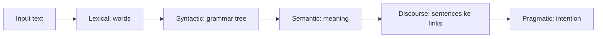

**In simple words:** Natural Language Processing (NLP) AI ka wo hissa hai jisse computer insaani language (English, Hindi) padh, samajh aur bana sakta hai. Iske liye text kai stages se guzarta hai, words todne se lekar speaker ka intention samajhne tak. <Cite id="nlp-introduction-slp3" /> <Cite id="nlp-introduction-ibm-nlp" />

**Kyun zaroori hai:** log machines se apni language mein baat karna chahte hain (voice assistants, search, translation, chatbots). Language mein bahut ambiguity hoti hai, isliye sirf fixed rules kaafi nahi.

**NLP ke stages** (running example: "The boy ate a mango. He liked it.") <Cite id="nlp-introduction-gfg-phases" />

1. **Lexical analysis (tokenization).** Text ko sentences aur words mein todo: The | boy | ate | a | mango. Root forms bhi nikalo (*ate* se *eat*).
2. **Syntactic analysis (parsing).** Grammar check karo aur parse tree banao: [The boy] subject (NP) hai, [ate a mango] verb phrase (VP) hai. "Boy the ate mango a" reject ho jaata hai.
3. **Semantic analysis.** Literal meaning nikalo: *ate* ka ek khane wala (boy) aur ek khayi gayi cheez (mango) hai. "The mango ate the boy" grammatical hai par meaningless, to reject hota hai.
4. **Discourse integration.** Sentences ko jodo: "He liked it" mein *He* boy hai aur *it* mango hai.
5. **Pragmatic analysis.** Situation se intended meaning nikalo: "Can you pass the salt?" ek request hai, ability ka sawaal nahi.

<Cite id="nlp-introduction-gfg-phases" loc="diagram" />

| Stage | Kaun sa sawaal | Example |
|---|---|---|
| Lexical | Words kaun se hain? | boy, ate, mango |
| Syntactic | Structure sahi hai? | NP + VP |
| Semantic | Meaning kya hai? | eat(boy, mango) |
| Discourse | *he*, *it* kis ke liye hain? | he = boy |
| Pragmatic | Asal mein kya kehna hai? | request vs. question |

**Applications:** machine translation, chatbots, sentiment analysis, search, summarization. <Cite id="nlp-introduction-tp-nlp" />

**Conclusion:** NLP language ko layers mein samajhta hai, words se grammar, meaning, context aur intention tak.
