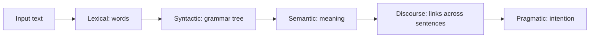

**In simple words:** Natural Language Processing (NLP) is the part of AI that lets computers read, understand and produce human language such as English or Hindi. To do this, text passes through several stages, from splitting words to understanding the speaker's intention. <Cite id="nlp-introduction-slp3" /> <Cite id="nlp-introduction-ibm-nlp" />

**Why it is needed:** people want to talk to machines in their own language (voice assistants, search, translation, chatbots). Language is full of ambiguity, so it cannot be handled by fixed rules alone.

**Stages of NLP** (running example: "The boy ate a mango. He liked it.") <Cite id="nlp-introduction-gfg-phases" />

1. **Lexical analysis (tokenization).** Split the text into sentences and words: The | boy | ate | a | mango. Also find the root forms (*ate* to *eat*).
2. **Syntactic analysis (parsing).** Check grammar and build a parse tree: [The boy] is the subject (NP), [ate a mango] is the verb phrase (VP). "Boy the ate mango a" is rejected.
3. **Semantic analysis.** Find the literal meaning: *ate* has an eater (boy) and a thing eaten (mango). A sentence like "The mango ate the boy" is grammatical but meaningless and is rejected.
4. **Discourse integration.** Link sentences: in "He liked it", *He* is the boy and *it* is the mango.
5. **Pragmatic analysis.** Use the situation to get the intended meaning: "Can you pass the salt?" is a request, not a question about ability.

<Cite id="nlp-introduction-gfg-phases" loc="diagram" />

| Stage | Question it answers | Example |
|---|---|---|
| Lexical | What are the words? | boy, ate, mango |
| Syntactic | Is the structure correct? | NP + VP |
| Semantic | What does it mean? | eat(boy, mango) |
| Discourse | What do *he*, *it* refer to? | he = boy |
| Pragmatic | What is really meant? | request vs. question |

**Applications:** machine translation, chatbots, sentiment analysis, search, summarization. <Cite id="nlp-introduction-tp-nlp" />

**Conclusion:** NLP understands language in layers, moving from words to grammar, meaning, context and intention.
