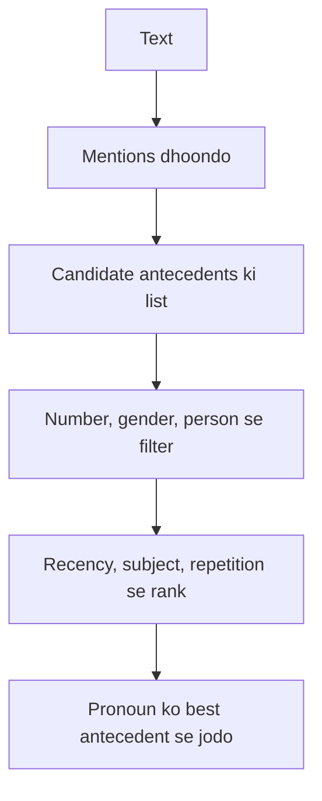

**In simple words:** text mein hum naam baar-baar nahi dohrate; hum *he*, *it*, *the company* kehte hain. **Reference resolution** ye problem hai ki aise har word ka real cheez kaun si hai, ye dhoondhna. <Cite id="discourse-reference-slp3-coref" />

**Terms.**

- **Referring expression:** wo phrase jo kisi ki taraf point karta hai (*he*, *the boy*, *this*).
- **Referent:** wo asli insaan ya cheez jiski taraf wo point karta hai.
- **Antecedent:** pehle aaya hua phrase jiski taraf expression wapas refer karta hai.
- **Anaphora:** peeche refer karna (*Ravi came. **He** sat.*). **Cataphora:** aage refer karna (*When **he** came, Ravi sat*). <Cite id="discourse-reference-wiki-anaphora" />
- **Coreference:** do expressions ka referent same ho; aise group ko coreference chain kehte hain. <Cite id="discourse-reference-wiki-coref" />

**Referring expressions ke types:** pronouns (*he, it*), definite noun phrases (*the boy*), indefinite noun phrases (*a boy*), demonstratives (*this, that*) aur names (*Ravi*).

**Kyun mushkil hai.** "Ravi told Amit that he had won." *he* Ravi hai ya Amit? Sirf grammar se tay nahi hota. "The trophy did not fit in the suitcase because it was too big" mein world knowledge chahiye (*it* = trophy).

**Kaise solve hota hai**

1. Saare mentions (nouns, pronouns) dhoondo.
2. Pronoun ke liye candidate antecedents ki list banao.
3. Jo **constraints** todte hain unhe hatao: number (*they*, *Ravi* nahi ho sakta), gender (*she*, *Ravi* nahi), person, aur grammar rules.
4. **Preferences** se chuno: recent mention, object ke upar subject, baar-baar aaya mention, parallel roles, verb ka meaning.
5. Pronoun ko jodo aur chain update karo.

<Cite id="anaphora-resolution-ibm-coref" loc="diagram" />

**Algorithms.** **Hobbs' algorithm (1978)** current aur pichhle sentences ke parse trees ko fixed order mein chalta hai aur pehla fit hone wala noun phrase chunta hai. **Centering** track karta hai ki discourse kis ke baare mein hai. Modern systems annotated text par train kiye machine-learning models use karte hain. <Cite id="anaphora-resolution-hobbs1978" />

| Constraint | Preference |
|---|---|
| Honi hi chahiye (number, gender) | Likely hai par override ho sakti hai (recency, subject) |
| Candidates hatati hai | Candidates ko rank karti hai |

**Conclusion:** reference resolution constraints, preferences aur kabhi-kabhi world knowledge se pronouns aur phrases ko unke antecedents se jodta hai.
