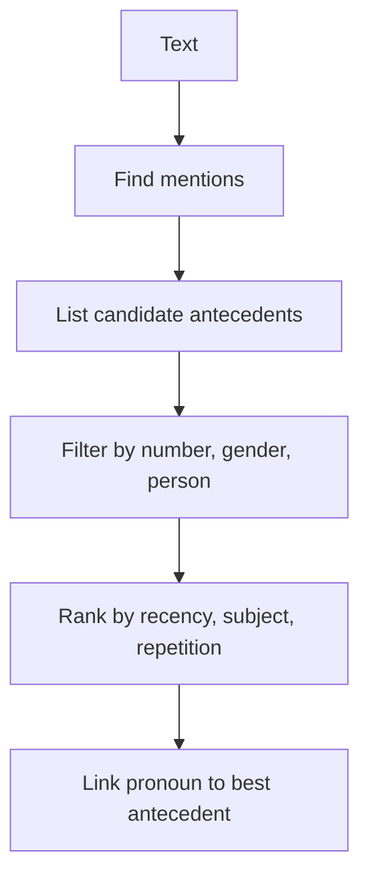

**In simple words:** in a text we do not repeat names again and again; we say *he*, *it*, *the company*. **Reference resolution** is the problem of finding which real thing each such word points to. <Cite id="discourse-reference-slp3-coref" />

**Terms.**

- **Referring expression:** the phrase that points to something (*he*, *the boy*, *this*).
- **Referent:** the real person or thing it points to.
- **Antecedent:** the earlier phrase that the expression refers back to.
- **Anaphora:** referring back (*Ravi came. **He** sat.*). **Cataphora:** referring forward (*When **he** came, Ravi sat*). <Cite id="discourse-reference-wiki-anaphora" />
- **Coreference:** two expressions with the same referent; the group is a coreference chain. <Cite id="discourse-reference-wiki-coref" />

**Types of referring expressions:** pronouns (*he, it*), definite noun phrases (*the boy*), indefinite noun phrases (*a boy*), demonstratives (*this, that*) and names (*Ravi*).

**Why it is hard.** "Ravi told Amit that he had won." Does *he* mean Ravi or Amit? Grammar alone cannot decide. "The trophy did not fit in the suitcase because it was too big" needs world knowledge (*it* = trophy).

**How it is solved**

1. Find all mentions (nouns, pronouns).
2. For a pronoun, list candidate antecedents.
3. Remove those that break **constraints**: number (*they* cannot be *Ravi*), gender (*she* is not *Ravi*), person, and grammar rules.
4. Choose using **preferences**: recent mention, subject over object, repeated mention, parallel roles, verb meaning.
5. Link the pronoun and update the chain.

<Cite id="anaphora-resolution-ibm-coref" loc="diagram" />

**Algorithms.** **Hobbs' algorithm (1978)** walks the parse trees of the current and previous sentences in a fixed order and picks the first noun phrase that fits. **Centering** tracks what the discourse is about. Modern systems use machine-learning models trained on annotated text. <Cite id="anaphora-resolution-hobbs1978" />

| Constraint | Preference |
|---|---|
| Must hold (number, gender) | Likely but can be overridden (recency, subject) |
| Removes candidates | Ranks candidates |

**Conclusion:** reference resolution links pronouns and phrases to their antecedents using constraints, preferences and sometimes world knowledge.
