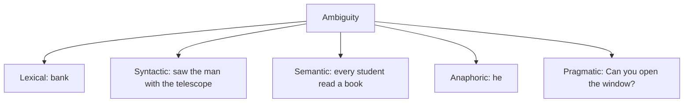

**In simple words:** sentence **ambiguous** hota hai jab use ek se zyada tarah se samjha ja sakta ho. Insaan common sense se sahi meaning chun leta hai; computer ko ye sikhana padta hai. Ambiguity hi NLP ke mushkil hone ki main wajah hai. <Cite id="ambiguity-challenges-wiki-ambiguity" /> <Cite id="ambiguity-challenges-gfg-ambiguity" />

**Ambiguity ke types, examples ke saath**

1. **Lexical ambiguity.** Ek word, kai meanings ya classes. "I went to the **bank**" (paisa ya nadi). "**Book** a ticket" (verb) vs "read a **book**" (noun).
2. **Syntactic (structural) ambiguity.** Ek sentence, ek se zyada parse tree. "I saw the man with the telescope": ya to maine telescope se dekha, ya aadmi ke paas telescope tha.
3. **Semantic ambiguity.** Words aur grammar clear hain par meaning nahi. "Every student read a book": kya sabne ek hi book padhi, ya har ek ne alag?
4. **Anaphoric (referential) ambiguity.** Pronoun ke ek se zyada possible antecedents. "Ravi told Amit he was late."
5. **Pragmatic ambiguity.** Meaning situation par depend karta hai. "Can you open the window?" sawaal hai ya request. <Cite id="ambiguity-challenges-tp-ambiguities" />

<Cite id="ambiguity-challenges-gfg-ambiguity" loc="diagram" />

**Resolve karne ke tareeke**

| Ambiguity | Method |
|---|---|
| Lexical | POS tagging (noun ya verb), context se word sense disambiguation (Lesk, supervised) |
| Syntactic | Probabilistic parsing: sabse probable tree chuno; subcategorization ka use |
| Semantic | Context aur world knowledge; selectional restrictions (*eat* ko food chahiye) ajeeb readings hatati hain |
| Anaphoric | Reference resolution: gender aur number agreement, recency |
| Pragmatic | Dialogue context, speaker ka intention, user se pooch lena |

General idea: **context** aur bade text ki **statistics** use karo, aur kai readings tab tak rakho jab tak baad ke stages decide na kar dein. <Cite id="ambiguity-challenges-slp3" />

**Conclusion:** ambiguity word, structure, meaning, reference aur situation levels par aati hai, aur har level ke apne tools sahi reading chunte hain.
