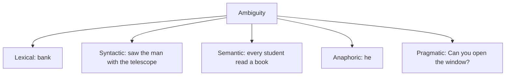

**In simple words:** a sentence is **ambiguous** when it can be understood in more than one way. Humans use common sense to pick the right meaning; a computer must be taught how. Ambiguity is the main reason NLP is hard. <Cite id="ambiguity-challenges-wiki-ambiguity" /> <Cite id="ambiguity-challenges-gfg-ambiguity" />

**Types of ambiguity with examples**

1. **Lexical ambiguity.** One word, many meanings or classes. "I went to the **bank**" (money or river). "**Book** a ticket" (verb) vs "read a **book**" (noun).
2. **Syntactic (structural) ambiguity.** One sentence, more than one parse tree. "I saw the man with the telescope": either I used the telescope, or the man had it.
3. **Semantic ambiguity.** The words and grammar are clear but the meaning is not. "Every student read a book": did all students read the same book, or each a different one?
4. **Anaphoric (referential) ambiguity.** A pronoun has more than one possible antecedent. "Ravi told Amit he was late."
5. **Pragmatic ambiguity.** The meaning depends on the situation. "Can you open the window?" is a question or a request. <Cite id="ambiguity-challenges-tp-ambiguities" />

<Cite id="ambiguity-challenges-gfg-ambiguity" loc="diagram" />

**Ways to resolve it**

| Ambiguity | Method |
|---|---|
| Lexical | POS tagging (noun or verb), word sense disambiguation using context (Lesk, supervised) |
| Syntactic | Probabilistic parsing: choose the most probable tree; use of subcategorization |
| Semantic | Context and world knowledge; selectional restrictions (*eat* needs food) rule out odd readings |
| Anaphoric | Reference resolution: gender and number agreement, recency |
| Pragmatic | Dialogue context, speaker intention, ask the user |

General idea: use the **context** and **statistics** from large text, and keep several readings until later stages decide. <Cite id="ambiguity-challenges-slp3" />

**Conclusion:** ambiguity appears at word, structure, meaning, reference and situation levels, and each level has its own tools to pick the right reading.
