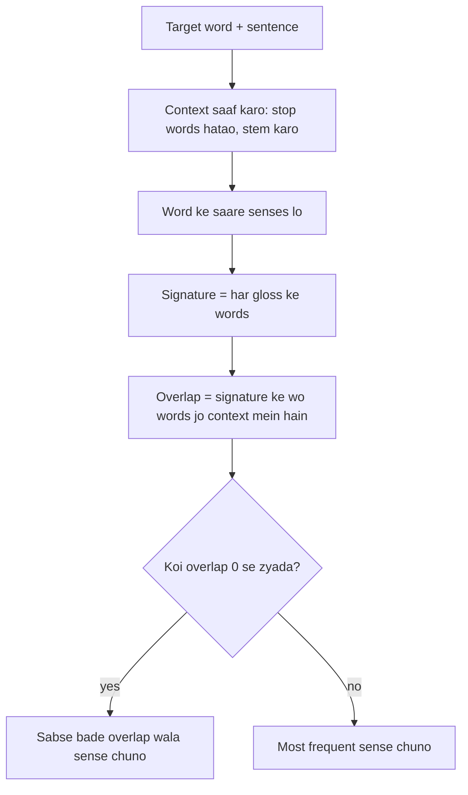

**In simple words:** Lesk's algorithm (Michael Lesk, 1986) ambiguous word ka meaning chunta hai: har meaning ki dictionary definition ko aas-paas ke words se compare karta hai. Jis meaning ki definition sentence ke sabse zyada words se milti hai, wo jeet jaata hai. <Cite id="word-sense-disambiguation-wiki-lesk" /> <Cite id="word-sense-disambiguation-slp3-I" loc="§I.5.2" />

**Idea.** Ek sentence ke words ek hi topic ki baat karte hain, to sahi definition mein aas-paas ke kuch words hone chahiye. Lesk **knowledge-based** method hai: use WordNet jaisi dictionary chahiye, labelled training data nahi.

**Steps (simplified Lesk)**

1. Target word aur uska sentence lo; baaki words **context** hain.
2. Stop words (the, in, of) hatao aur words ko stem karo.
3. Target word ke har sense ka **gloss** (definition, aur examples agar hon) lo; ye uski **signature** hai.
4. **Overlap** ginti karo: signature aur context ke common words.
5. Sabse bade overlap wala sense chuno. Agar sab zero hon to sabse frequent sense chuno. <Cite id="word-sense-disambiguation-cam-l98" />

<Cite id="word-sense-disambiguation-cam-l98" loc="diagram" />

<Sum>

<Given>

Word *bank*. WordNet glosses: **bank 1** = "a financial institution that accepts deposits and channels the money into lending activities"; **bank 2** = "sloping land (especially the slope beside a body of water)". Sentence A: "I deposited money in the bank." Sentence B: "He sat by the bank and watched the water." <Cite id="word-sense-disambiguation-slp3-I" loc="§I.5.2" />

</Given>

<Find>

har sentence mein *bank* ka sense.

</Find>

<Steps>

1. **Sentence A ka context** (stop words aur *bank* hataye, stem kiye): \{deposit, money\}.
2. **Signature 1** (stems, stop words hataye): \{financial, institution, accept, deposit, channel, money, lend, activity\}. A ke saath common: *deposit*, *money*, to overlap = 2.
3. **Signature 2:** \{slope, land, especially, beside, body, water\}. A ke saath common: koi nahi, overlap = 0. To A ko **bank 1** milta hai.
4. **Sentence B ka context:** \{sat, watch, water\}. *Reason: wahi safai.*
5. Signature 1 ke saath overlap = 0. Signature 2 ke saath overlap = 1 (*water*). To B ko **bank 2** milta hai.

</Steps>

<Answer>

Sentence A: bank 1 (financial institution), overlap 2 vs 0. Sentence B: bank 2 (nadi ka kinara), overlap 1 vs 0.

</Answer>

<Box kind="verify">

Common sense bhi yahi kehta hai: money aur deposits financial sense ki taraf, aur nadi ka water slope sense ki taraf point karte hain. Context ki taraf se dobara ginti: A mein dono context words sirf signature 1 mein hain; B mein ek hi matching word, *water*, sirf signature 2 mein hai.

</Box>

</Sum>

**Advantages:** labelled data nahi chahiye, simple, dictionary ke har word ke liye chalta hai. **Disadvantages:** gloss ke exact words par depend karta hai, chhote glosses se kam overlaps milte hain (ek word chhoot jaaye to answer palat sakta hai), aur accuracy supervised methods se kam hai. **Improvement:** extended Lesk related senses (hypernyms, hyponyms) ke glosses bhi use karta hai. <Cite id="word-sense-disambiguation-gfg-wsd" />

**Conclusion:** Lesk wo sense chunta hai jiski definition sentence se sabse zyada overlap karti hai.
