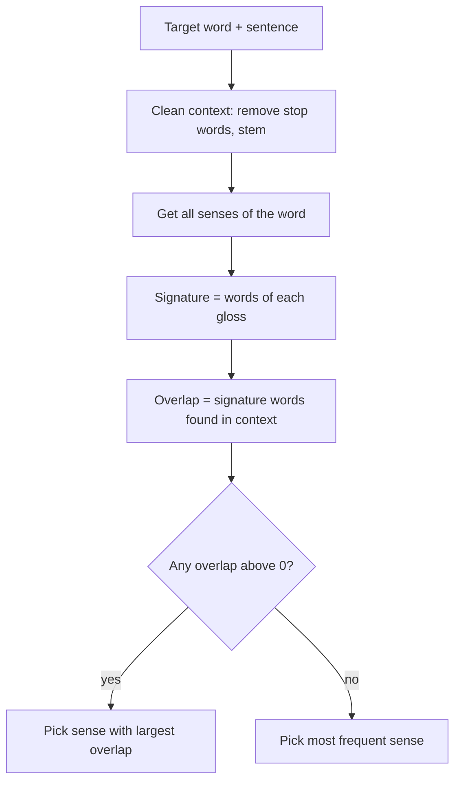

**In simple words:** Lesk's algorithm (Michael Lesk, 1986) chooses the meaning of an ambiguous word by comparing the dictionary definition of each meaning with the words around it. The meaning whose definition shares the most words with the sentence wins. <Cite id="word-sense-disambiguation-wiki-lesk" /> <Cite id="word-sense-disambiguation-slp3-I" loc="§I.5.2" />

**Idea.** Words in one sentence talk about the same topic, so the right definition should contain some of the neighbouring words. Lesk is a **knowledge-based** method: it needs a dictionary such as WordNet, not labelled training data.

**Steps (simplified Lesk)**

1. Take the target word and its sentence; the other words are the **context**.
2. Remove stop words (the, in, of) and reduce words to their stem.
3. For every sense of the target word, take its **gloss** (definition, plus examples if any); this is its **signature**.
4. Count the **overlap**: words common to the signature and the context.
5. Choose the sense with the biggest overlap. If all are zero, choose the most frequent sense. <Cite id="word-sense-disambiguation-cam-l98" />

<Cite id="word-sense-disambiguation-cam-l98" loc="diagram" />

<Sum>

<Given>

Word *bank*. WordNet glosses: **bank 1** = "a financial institution that accepts deposits and channels the money into lending activities"; **bank 2** = "sloping land (especially the slope beside a body of water)". Sentence A: "I deposited money in the bank." Sentence B: "He sat by the bank and watched the water." <Cite id="word-sense-disambiguation-slp3-I" loc="§I.5.2" />

</Given>

<Find>

the sense of *bank* in each sentence.

</Find>

<Steps>

1. **Sentence A context** (stop words and *bank* removed, stemmed): \{deposit, money\}.
2. **Signature 1** (stems, stop words removed): \{financial, institution, accept, deposit, channel, money, lend, activity\}. Common with A: *deposit*, *money*, so overlap = 2.
3. **Signature 2:** \{slope, land, especially, beside, body, water\}. Common with A: none, overlap = 0. So A gets **bank 1**.
4. **Sentence B context:** \{sat, watch, water\}. *Reason: same cleaning.*
5. Overlap with signature 1 = 0. Overlap with signature 2 = 1 (*water*). So B gets **bank 2**.

</Steps>

<Answer>

Sentence A: bank 1 (financial institution), overlap 2 against 0. Sentence B: bank 2 (river side), overlap 1 against 0.

</Answer>

<Box kind="verify">

Common sense agrees: money and deposits point to the financial sense and a river's water to the slope sense. Recount from the context side: in A both context words appear in signature 1 only; in B the only matching word, *water*, is in signature 2 only.

</Box>

</Sum>

**Advantages:** needs no labelled data, simple, works for any word in the dictionary. **Disadvantages:** depends on the exact words in the gloss, short glosses give few overlaps (one missing word can flip the answer), and accuracy is lower than supervised methods. **Improvements:** extended Lesk also uses the glosses of related senses (hypernyms, hyponyms). <Cite id="word-sense-disambiguation-gfg-wsd" />

**Conclusion:** Lesk picks the sense whose definition overlaps most with the sentence.
