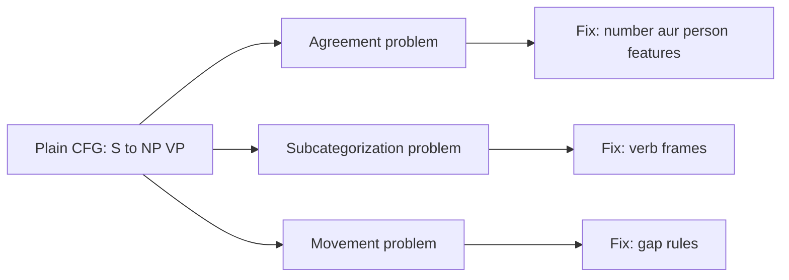

**In simple words:** plain CFG sentence ki shape mein achhi hai par words ke beech ki chhoti agreements check nahi kar sakti. Teen jaani-maani problems hain: agreement, subcategorization aur movement.

*(Class question bank ye teen problems list karta hai <Cite id="class-nlp-qb1" loc="Module 3" /> par class files mein inke notes nahi hain; ye standard short answer hai.)*

**1. Agreement:** words ko number, person aur gender mein match karna chahiye. "He walks" sahi hai, "He walk" galat; "The dogs bark" sahi hai, "The dogs barks" galat. S → NP VP wali plain CFG galat sentences ko bhi accept kar leti hai. Inhe rokne ke liye singular aur plural ke alag rules banane padte hain (S → NP-sg VP-sg, S → NP-pl VP-pl, aur aise hi), isliye grammar bahut bada ho jaata hai. *Remedy:* symbols mein number aur person jaise features jodo aur unka match hona zaroori karo.

**2. Subcategorization:** verb sirf kuch khaas complements leta hai. *Sleep* object nahi leta ("He sleeps"), *eat* ek object le sakta hai ("He eats rice"), *give* do leta hai ("He gave her a book"). "He sleeps a book" galat hai, par S → NP VP aur VP → V NP ise allow kar dete. *Remedy:* verbs ko types mein baanto (intransitive, transitive, ditransitive) aur har ke liye alag rule do, ya har verb ke allowed complements (uska subcategorization frame) store karo.

**3. Movement:** koi phrase apni normal jagah se door aa jaata hai. "What book did you read?" mein *book*, *read* ka object hai, par wo shuru mein hai; *read* ke baad gap hai. Simple CFG object ko verb ke baad expect karti hai, isliye wo moved phrase ko uske gap se jod nahi sakti. *Remedy:* aise rules jodo jo missing phrase ko record karein (gap ya "slash" category) aur use tree mein neeche pass karein.

| Problem | Galat sentence | Plain CFG kyun fail | Remedy |
|---|---|---|---|
| Agreement | He walk | Number aur person ka check nahi | Features jo match karein |
| Subcategorization | He sleeps a book | Pata nahi verb kya leta hai | Verb types ya frames |
| Movement | What book did you read? | Object apne verb se door | Gap (slash) rules |

**Conclusion:** ye teen problems dikhati hain ki asli language describe karne ke liye plain CFG rules ko extra information, features, verb frames aur gap rules, chahiye.
