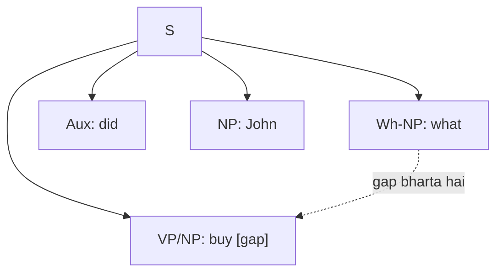

**In simple words:** context-free grammar (CFG) rules ka set hai, jaise `S → NP VP`, jo batata hai ki sentence phrases se kaise bante hain. Ye achhi shuruaat hai, par English ke teen patterns plain CFG rules se saaf-saaf nahi sambhalte: agreement, subcategorization aur movement. Star `*` galat sentence dikhata hai. <Cite id="cfg-parsing-slp3-F" loc="§F.3" />

**1) Agreement.** Words ko number, person (aur Hindi mein gender) mein match karna padta hai. <Cite id="cfg-parsing-wiki-agree" />

- Sahi: `She sings`, `These books`. Galat: `*She sing`, `*This books`.
- Problem: rule `S → NP VP` `*She sing` ko accept kar leta hai, kyunki wo number ignore karta hai. Ise rokne ke liye rules ko singular aur plural versions mein todna padta hai (`S → NP-sg VP-sg`, `S → NP-pl VP-pl`, aur NP, Det, N, V ke liye bhi). Person jodne par grammar bahut bada ho jaata hai.
- Fix: symbols ko **features** (number, person) do aur unka match hona zaroori karo, jaise unification grammars mein. 

**2) Subcategorization.** Har verb ke baad sirf kuch complements aa sakte hain (uska **frame**). <Cite id="cfg-parsing-wiki-subcat" />

| Verb type | Frame | Sahi | Galat |
|---|---|---|---|
| Intransitive | V | `The girl sleeps` | `*The girl sleeps the book` |
| Transitive | V NP | `She reads a book` | `*She devours` |
| Ditransitive | V NP NP | `He gave her a pen` | `*He gave` |
| Sentence complement | V S | `I think that she sings` | `*I think a book` |

- Problem: ek rule `VP → V NP` se har verb object le sakta hai, to `*The girl sleeps the book` accept ho jaata hai. Grammar ko alag verb classes aur har ek ka VP rule chahiye, jisse wo bada ho jaata hai.
- Fix: har verb ka frame lexicon mein rakho aur VP rule use check kare.

**3) Movement.** Ek phrase wahan nahi hota jahan logically use hona chahiye. <Cite id="cfg-parsing-wiki-whmove" />

- Example: `What did John buy?` mein *what*, *buy* ka object hai par aage aa gaya. Passives (`The book was read by Mary`) bhi object ko subject ki jagah le jaate hain. Doori lambi ho sakti hai: `Which book did you say she read?`
- Problem: CFG rule sirf apne children dekhta hai, to wo keh nahi sakta ki sentence mein aage ka gap pehle aaye word se bharta hai. Har gap position ke liye rules chahiye, aur doori unlimited hai.
- Fix: **gap** (trace) aur slash categories use karo: `S/NP` ka matlab "ek sentence jisme ek NP missing hai", jo tree mein neeche jaata hai jab tak *buy* use use na kar le.

<Cite id="cfg-parsing-tp-syn" loc="diagram" />

| Problem | Plain CFG kyun fail hota hai | Fix |
|---|---|---|
| Agreement | number aur person ignore karta hai | features, unification |
| Subcategorization | verb frames mein fark nahi kar sakta | lexicon mein frames |
| Movement | rules local hain, gaps door hain | gaps, slash categories |

**Conclusion:** teeno problems ek hi wajah se aati hain: CFG rule local hota hai aur use features, verb type ya door ke words ki yaad nahi hoti. Richer grammars (features, slash categories) ya statistical parsers iska usual ilaaj hain.
