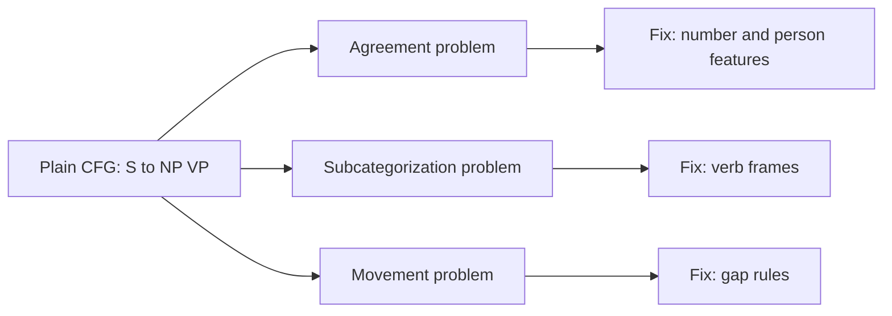

**In simple words:** a plain CFG is good at the shape of a sentence but cannot check small agreements between words. Three well-known problems are agreement, subcategorization and movement.

*(The class question bank lists these three problems <Cite id="class-nlp-qb1" loc="Module 3" /> but the class files give no notes on them; this is the standard short answer.)*

**1. Agreement:** words must match in number, person and gender. "He walks" is right, "He walk" is wrong; "The dogs bark" is right, "The dogs barks" is wrong. A plain CFG with the rule S → NP VP accepts the wrong sentences too. To block them we must make separate rules for singular and plural (S → NP-sg VP-sg, S → NP-pl VP-pl, and so on), so the grammar becomes very large. *Remedy:* add features such as number and person to the symbols and require them to match.

**2. Subcategorization:** a verb allows only certain complements. *Sleep* takes no object ("He sleeps"), *eat* may take one ("He eats rice"), *give* takes two ("He gave her a book"). "He sleeps a book" is wrong, yet S → NP VP and VP → V NP would allow it. *Remedy:* split verbs into types (intransitive, transitive, ditransitive) with a separate rule for each, or store the allowed complements of each verb (its subcategorization frame).

**3. Movement:** a phrase appears away from its normal place. In "What book did you read?" the word *book* is the object of *read*, but it is at the start; there is a gap after *read*. A simple CFG expects the object after the verb, so it cannot connect the moved phrase with its gap. *Remedy:* add rules that record the missing phrase (a gap or "slash" category) and pass it down the tree.

| Problem | Wrong sentence | Why a plain CFG fails | Remedy |
|---|---|---|---|
| Agreement | He walk | No check of number and person | Features that must match |
| Subcategorization | He sleeps a book | Does not know what the verb takes | Verb types or frames |
| Movement | What book did you read? | Object is far from its verb | Gap (slash) rules |

**Conclusion:** the three problems show that plain CFG rules need extra information, features, verb frames and gap rules, to describe real language.
