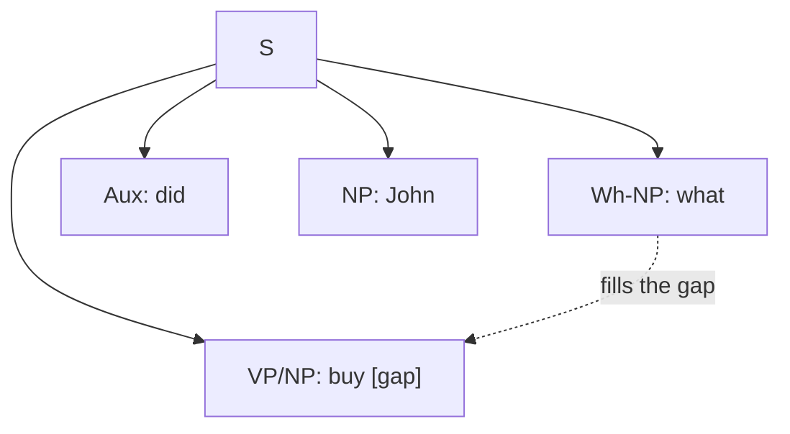

**In simple words:** a context-free grammar (CFG) is a set of rules like `S → NP VP` that says how a sentence is built from phrases. It is a good start, but English has three patterns that plain CFG rules cannot handle neatly: agreement, subcategorization and movement. A star `*` marks a wrong sentence. <Cite id="cfg-parsing-slp3-F" loc="§F.3" />

**1) Agreement.** Words must match in number, person (and in Hindi, gender). <Cite id="cfg-parsing-wiki-agree" />

- Good: `She sings`, `These books`. Bad: `*She sing`, `*This books`.
- Problem: the rule `S → NP VP` accepts `*She sing`, because it ignores number. To stop this we must split the rules into singular and plural versions (`S → NP-sg VP-sg`, `S → NP-pl VP-pl`, and the same for NP, Det, N, V). With person added the grammar multiplies in size.
- Fix: give symbols **features** (number, person) and require them to match, as in unification grammars.

**2) Subcategorization.** Each verb allows only certain complements after it (its **frame**). <Cite id="cfg-parsing-wiki-subcat" />

| Verb type | Frame | Good | Bad |
|---|---|---|---|
| Intransitive | V | `The girl sleeps` | `*The girl sleeps the book` |
| Transitive | V NP | `She reads a book` | `*She devours` |
| Ditransitive | V NP NP | `He gave her a pen` | `*He gave` |
| Sentence complement | V S | `I think that she sings` | `*I think a book` |

- Problem: with the single rule `VP → V NP`, every verb can take an object, so `*The girl sleeps the book` is accepted. The grammar needs separate verb classes and a VP rule for each, which makes it large.
- Fix: store each verb's frame in the lexicon and let the VP rule check it.

**3) Movement.** A phrase appears far from the place where it logically belongs. <Cite id="cfg-parsing-wiki-whmove" />

- Example: in `What did John buy?`, *what* is the object of *buy* but sits at the front. Passives (`The book was read by Mary`) also move the object to the subject place. The distance can be long: `Which book did you say she read?`
- Problem: a CFG rule sees only its own children, so it cannot say that a gap later in the sentence is filled by a word earlier. Rules for every gap position would be needed, and the distance is unlimited.
- Fix: use a **gap** (trace) and slash categories: `S/NP` means "a sentence missing an NP", passed down the tree until *buy* uses it.

<Cite id="cfg-parsing-tp-syn" loc="diagram" />

| Problem | Why plain CFG fails | Fix |
|---|---|---|
| Agreement | ignores number and person | features, unification |
| Subcategorization | cannot tell verb frames apart | frames in the lexicon |
| Movement | rules are local, gaps are distant | gaps, slash categories |

**Conclusion:** all three problems come from one cause: a CFG rule is local and has no memory of features, verb type or distant words. Richer grammars (features, slash categories) or statistical parsers are the usual cure.
