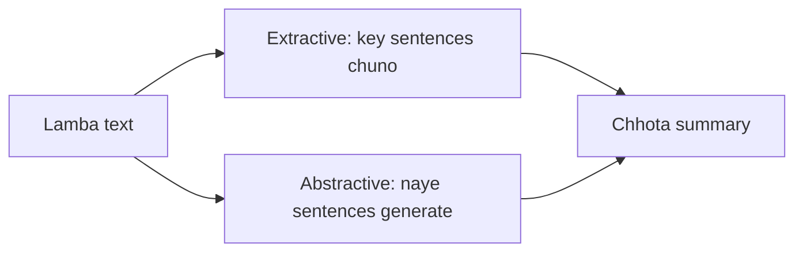

**In simple words:** text summarization lambe text ko chhota karta hai aur important information rakhta hai. <Cite id="class-nlp-m6" loc="slide 23" />

**Definition:** summarization NLP ki technique hai jo algorithms se bade texts ko chhota karti hai aur essential information bachati hai. Do types: extractive aur abstractive.

| Point | Extractive | Abstractive |
|---|---|---|
| How | text ke key sentences chunkar jodta hai, naya content nahi | bilkul naye sentences generate karta hai, aksar naye words ke saath |
| Method | TextRank sentences ko importance se rank karta hai | pehle RNN models, ab Transformers |

<Cite id="class-nlp-m6" loc="slide 24" /><Cite id="class-nlp-m6" loc="slide 25" />

**Uses:** banking, law, healthcare. **Conclusion:** dono same meaning ka chhota text dete hain.
