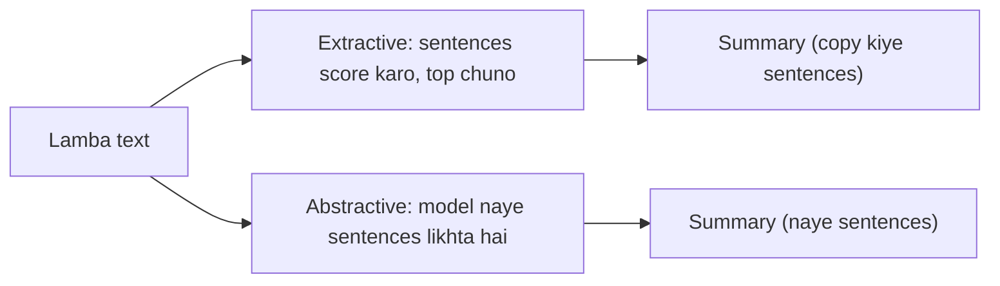

**In simple words:** text summarization lambe text (news, paper, report) ko chhote text mein badal deta hai jisme main points bache rehte hain. <Cite id="pyq-2024-12-gfg-summ" /> <Cite id="ambiguity-challenges-wiki-summ" />

**Kyun zaroori hai:** logon ke paas padhne ko bahut kuch hai. Summary news apps, legal aur medical reports, aur search result snippets mein time bachati hai.

**Types**

1. **Extractive:** text se sabse important sentences chuno aur jodo. Ranking word frequency, sentence position ya TextRank graph algorithm se hoti hai. Summary mein sirf original words hote hain.
2. **Abstractive:** text samjho aur insaan ki tarah naye sentences likho. Ye neural sequence-to-sequence ya transformer models use karta hai. Padhne mein achha lagta hai par galat facts bol sakta hai.

**Simple extractive method ke steps:** sentences mein todo, stop words hatao, word frequencies ginti karo, har sentence ko uske words se score do, top kuch sentences original order mein chuno.

**Limits:** extractive summaries jhatke wali ho sakti hain; abstractive facts bana sakti hain. Quality ROUGE se check hoti hai (human summary se overlap).

**Conclusion:** summarization text ko ya to sentences chun kar ya unhe dobara likh kar chhota karti hai.
