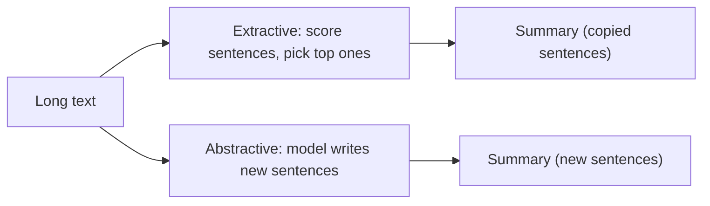

**In simple words:** text summarization shortens a long text (news, a paper, a report) into a short one that keeps the main points. <Cite id="pyq-2024-12-gfg-summ" /> <Cite id="ambiguity-challenges-wiki-summ" />

**Why it is needed:** people have too much to read. A summary saves time in news apps, legal and medical reports, and search result snippets.

**Types**

1. **Extractive:** pick the most important sentences from the text and join them. Ranking uses word frequency, sentence position or the TextRank graph algorithm. The summary uses only the original words.
2. **Abstractive:** understand the text and write new sentences, as a person does. It uses neural sequence-to-sequence or transformer models. It reads better but can state wrong facts.

**Steps of a simple extractive method:** split into sentences, remove stop words, count word frequencies, score each sentence by its words, pick the top few in original order.

**Limits:** extractive summaries can be choppy; abstractive ones can invent facts. Quality is checked with ROUGE (overlap with a human summary).

**Conclusion:** summarization compresses text either by selecting sentences or by rewriting them.
