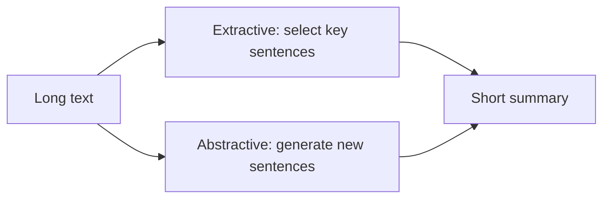

**In simple words:** text summarization shortens a long text and keeps the important information. <Cite id="class-nlp-m6" loc="slide 23" />

**Definition:** summarization is a technique in NLP that uses algorithms to reduce large texts while preserving essential information. Two types: extractive and abstractive.

| Point | Extractive | Abstractive |
|---|---|---|
| How | selects and combines key sentences from the text, no new content | generates entirely new sentences, often with new words |
| Method | TextRank ranks sentences by importance | RNN models earlier, Transformers now |

<Cite id="class-nlp-m6" loc="slide 24" /><Cite id="class-nlp-m6" loc="slide 25" />

**Uses:** banking, law, healthcare. **Conclusion:** both give a shorter text with the same meaning.
