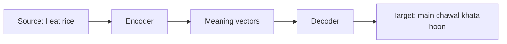

**In simple words:** machine translation (MT) text ko source language (jaise English) se target language (jaise Hindi) mein automatically badalta hai. <Cite id="pyq-2025-05-gfg-mt" /> <Cite id="ambiguity-challenges-wiki-mt" />

**Kyun mushkil hai:** word order alag hai (English: subject-verb-object, Hindi: subject-object-verb), words ke kai senses hain (*bank*), aur idioms word-by-word translate nahi hote.

**Approaches**

1. **Rule-based (direct, transfer, interlingua):** haath se likhe grammar rules aur dictionaries.
2. **Statistical (SMT):** parallel text (do languages mein same text) se word aur phrase probabilities seekho.
3. **Neural (NMT):** encoder-decoder network, ab transformers, poora sentence padhta hai aur translation likhta hai. Aaj sabse fluent output yahi deta hai. <Cite id="pyq-2025-05-slp3-mt" />

**Applications:** Google Translate, subtitles, multilingual websites. **Limits:** rare languages ka parallel data kam hota hai, aur meaning ki galtiyan abhi bhi hoti hain.

**Conclusion:** MT rules se statistics se neural networks tak aaya hai, jo poore sentence ko context mein translate karte hain.
