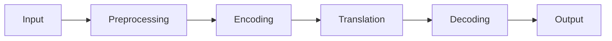

**In simple words:** machine translation (MT) NLP se text ya speech ko ek language se dusri mein automatically translate karta hai. <Cite id="class-nlp-m6" loc="slide 1" />

**Working:** source language mein input, tokens mein preprocessing, meaning ka encoding, target language mein translation, best target tokens ka decoding aur output. Transformer systems attention se relevant source words pe focus karte hain. <Cite id="class-nlp-m6" loc="slide 2" />

**Methods:** rule-based (rules aur dictionaries), statistical (parallel corpora se probabilities), neural (RNN, LSTM, GRU, encoder-decoder, attention) aur Transformer-based (self-attention). <Cite id="class-nlp-m6" loc="slides 3-6" />

**Evaluation:** BLEU, ROUGE, METEOR aur human evaluation. **Applications:** localization, business aur customer support, education, subtitles. **Limits:** context aur cultural errors, kuch languages ka data kam. <Cite id="class-nlp-m6" loc="slides 6-8" />

**Conclusion:** modern MT fast aur scalable hai, aur neural aur Transformer models use karta hai.
