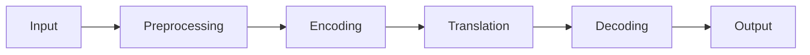

**In simple words:** machine translation (MT) translates text or speech from one language to another automatically using NLP. <Cite id="class-nlp-m6" loc="slide 1" />

**Working:** input in the source language, preprocessing into tokens, encoding of the meaning, translation into the target language, decoding of the best target tokens, and output. Transformer systems use attention to focus on the relevant source words. <Cite id="class-nlp-m6" loc="slide 2" />

**Methods:** rule-based (rules and dictionaries), statistical (probabilities from parallel corpora), neural (RNN, LSTM, GRU, encoder-decoder, attention) and Transformer-based (self-attention). <Cite id="class-nlp-m6" loc="slides 3-6" />

**Evaluation:** BLEU, ROUGE, METEOR and human evaluation. **Applications:** localization, business and customer support, education, subtitles. **Limits:** context and cultural errors, little data for some languages. <Cite id="class-nlp-m6" loc="slides 6-8" />

**Conclusion:** modern MT is fast and scalable, and uses neural and Transformer models.
