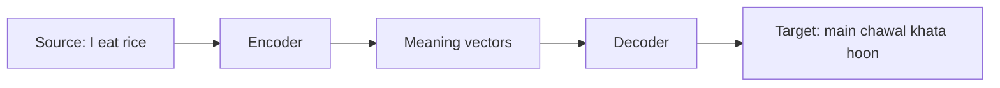

**In simple words:** machine translation (MT) automatically converts text from a source language (say English) into a target language (say Hindi). <Cite id="pyq-2025-05-gfg-mt" /> <Cite id="ambiguity-challenges-wiki-mt" />

**Why it is hard:** word order differs (English: subject-verb-object, Hindi: subject-object-verb), words have many senses (*bank*), and idioms cannot be translated word by word.

**Approaches**

1. **Rule-based (direct, transfer, interlingua):** hand-written grammar rules and dictionaries.
2. **Statistical (SMT):** learn word and phrase probabilities from parallel text (the same text in two languages).
3. **Neural (NMT):** an encoder-decoder network, now transformers, reads the whole sentence and writes the translation. It gives the most fluent output today. <Cite id="pyq-2025-05-slp3-mt" />

**Applications:** Google Translate, subtitles, multilingual websites. **Limits:** rare languages have little parallel data, and errors in meaning still occur.

**Conclusion:** MT has moved from rules to statistics to neural networks, which translate whole sentences in context.
