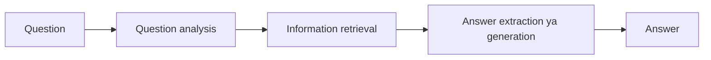

**In simple words:** QA system human language ke question ka chhota, exact answer deta hai, documents ki list nahi. <Cite id="class-nlp-m6" loc="slide 15" />

**Stages:** (1) **question analysis:** tokenize, stop words hatao, POS tag karo aur expected answer type nikaalo (who matlab person, when matlab date); (2) **information retrieval:** document store, knowledge graph ya vector database se relevant passages ya facts laao; (3) **answer extraction ya generation:** Transformer model (BERT ya LLM) exact answer chunta ya likhta hai. <Cite id="class-nlp-m6" loc="slides 15-16" />

**Types:** *extractive* (exact span nikaalta), *generative* (fluent answer likhta), *open-domain* (broad, web data) aur *closed-domain* (narrow subject, jaise medical ya legal). <Cite id="class-nlp-m6" loc="slide 16" />

**Conclusion:** QA = question analysis + retrieval + answer extraction.
