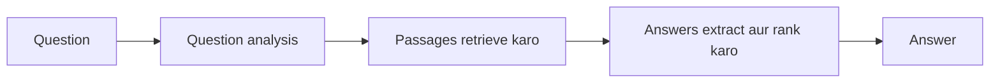

**In simple words:** question answering (QA) system natural language mein sawaal leta hai aur web pages ki list ke bajay seedha answer deta hai. Example: "Who wrote Hamlet?" ka answer "William Shakespeare." <Cite id="pyq-2024-12-ibm-qa" /> <Cite id="ambiguity-challenges-wiki-qa" />

**Typical QA system ke stages**

1. **Question analysis:** question type (who, when, where) aur expected answer type (person, date, place) dhoondo.
2. **Document retrieval:** information retrieval se wo passages dhoondo jinme answer ho sakta hai. <Cite id="pyq-2025-05-wiki-ir" />
3. **Answer extraction:** un passages mein best phrase dhoondo, aksar named entity recognition se.
4. **Answer ranking aur output.**

**Types:** extractive (answer text se copy) aur generative (answer language model likhta hai); open-domain (koi bhi topic) aur closed-domain (ek field jaise medicine); closed-book aur open-book. <Cite id="pyq-2024-12-ibm-qa" />

**Applications:** voice assistants, customer support chatbots, search engines. **Difficulties:** ambiguous questions, reasoning ki zaroorat, aur galat par confident answers.

**Conclusion:** QA retrieval aur language understanding ko jodkar answer khud deta hai.
