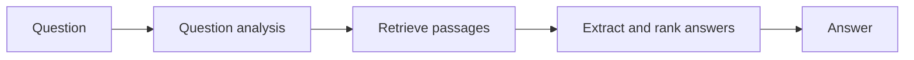

**In simple words:** a question answering (QA) system takes a question in natural language and returns a direct answer, not a list of web pages. Example: "Who wrote Hamlet?" gives "William Shakespeare." <Cite id="pyq-2024-12-ibm-qa" /> <Cite id="ambiguity-challenges-wiki-qa" />

**Stages of a typical QA system**

1. **Question analysis:** find the question type (who, when, where) and the expected answer type (person, date, place).
2. **Document retrieval:** use information retrieval to find the passages that may hold the answer. <Cite id="pyq-2025-05-wiki-ir" />
3. **Answer extraction:** locate the best phrase in those passages, often using named entity recognition.
4. **Answer ranking and output.**

**Types:** extractive (answer copied from text) and generative (answer written by a language model); open-domain (any topic) and closed-domain (one field such as medicine); closed-book and open-book. <Cite id="pyq-2024-12-ibm-qa" />

**Applications:** voice assistants, customer support chatbots, search engines. **Difficulties:** ambiguous questions, needing reasoning, and wrong confident answers.

**Conclusion:** QA combines retrieval and language understanding to give the answer itself.
