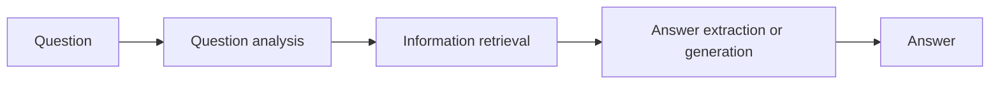

**In simple words:** a QA system gives a short, exact answer to a question in human language, not a list of documents. <Cite id="class-nlp-m6" loc="slide 15" />

**Stages:** (1) **question analysis:** tokenize, remove stop words, POS tag and find the expected answer type (who means person, when means date); (2) **information retrieval:** fetch relevant passages or facts from a document store, knowledge graph or vector database; (3) **answer extraction or generation:** a Transformer model (BERT or an LLM) picks or writes the exact answer. <Cite id="class-nlp-m6" loc="slides 15-16" />

**Types:** *extractive* (pulls an exact span), *generative* (writes a fluent answer), *open-domain* (broad, web data) and *closed-domain* (narrow subject like medical or legal). <Cite id="class-nlp-m6" loc="slide 16" />

**Conclusion:** QA = question analysis + retrieval + answer extraction.
