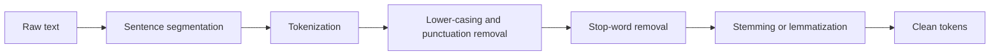

**In simple words:** raw text messy hota hai. Pre-processing use saaf karta hai aur chhote tukdon mein kaat deta hai taaki program us pe kaam kar sake. <Cite id="text-preprocessing-gfg-pre" /> <Cite id="text-preprocessing-av-pre" />

<Cite id="text-preprocessing-gfg-pre" loc="diagram" />

**Steps:**

1. **Sentence segmentation:** text ko `.`, `?`, `!` pe sentences mein todo. `Dr.` ya `3.5` pe dhyan rakhna padta hai.
2. **Tokenization:** sentence ko words (tokens) mein todo.
3. **Lower-casing (case folding):** `The` aur `the` ek hi word ban jaate hain.
4. **Punctuation aur noise hatana:** symbols, extra spaces, HTML tags hatao.
5. **Stop-word removal:** bahut common words jaise `the`, `is`, `on` hatao, inka meaning kam hota hai.
6. **Stemming:** rule se ending kaato (`running` se `run`, `studies` se `studi`).
7. **Lemmatization:** grammar use karke dictionary word wapas do (`better` se `good`, `studies` se `study`). <Cite id="text-preprocessing-ibm-stemlem" />

**Example:** "The cats are running quickly!" ke tokens `The cats are running quickly`, phir lower-case, phir stop words hata ke `cats running quickly`, phir stems `cat run quickli` (stem ka real word hona zaroori nahi).

**Note:** kaun se steps lagane hain wo task pe depend karta hai. Stop-word removal search mein kaam aata hai par sentiment mein nuksaan kar sakta hai (`not good`). <Cite id="text-preprocessing-slp3-ch2" />

**Conclusion:** pre-processing messy text ko clean, uniform tokens mein badalta hai, jisse aage ke NLP steps simple aur accurate ho jaate hain.

Exam mein English mein likho: "Pre-processing steps are sentence segmentation, tokenization, lower-casing, noise removal, stop-word removal, stemming and lemmatization."
