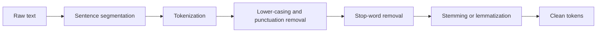

**In simple words:** raw text is messy. Pre-processing cleans it and cuts it into small pieces so a program can work on it. <Cite id="text-preprocessing-gfg-pre" /> <Cite id="text-preprocessing-av-pre" />

<Cite id="text-preprocessing-gfg-pre" loc="diagram" />

**Steps:**

1. **Sentence segmentation:** split the text into sentences at `.`, `?`, `!`. Care is needed for `Dr.` or `3.5`.
2. **Tokenization:** split a sentence into words (tokens).
3. **Lower-casing (case folding):** `The` and `the` become one word.
4. **Removing punctuation and noise:** drop symbols, extra spaces, HTML tags.
5. **Stop-word removal:** drop very common words such as `the`, `is`, `on`, which carry little meaning.
6. **Stemming:** chop endings by rule (`running` to `run`, `studies` to `studi`).
7. **Lemmatization:** return the dictionary word using grammar (`better` to `good`, `studies` to `study`). <Cite id="text-preprocessing-ibm-stemlem" />

**Example:** "The cats are running quickly!" gives tokens `The cats are running quickly`, then lower-case, then without stop words `cats running quickly`, then stems `cat run quickli` (a stem need not be a real word).

**Note:** which steps to use depends on the task. Stop-word removal helps search but can hurt sentiment (`not good`). <Cite id="text-preprocessing-slp3-ch2" />

**Conclusion:** pre-processing turns messy text into clean, uniform tokens, which makes later NLP steps simpler and more accurate.
