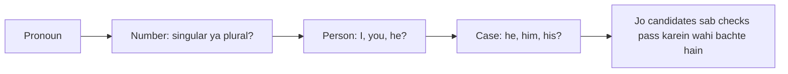

**In simple words:** pronoun sirf wahi noun ko refer kar sakta hai jo uske saath agree karta hai. Agreement rules impossible candidates hata dete hain. *(Class files mein ye question cover nahi hai; answer chhota aur standard hai.)*

**1. Number agreement:** singular pronoun ko singular antecedent chahiye aur plural pronoun ko plural. "The **chefs** made lunch. **She** served it." galat hai, kyunki *She* singular hai aur *chefs* plural. *they* ke saath *chefs* chalta hai.

**2. Person and case agreement:**

- **Person:** first (I, we), second (you) aur third person (he, she, it, they) match karne chahiye. "**Ram** said that **he** was late" mein *he* third person hai aur Ram se fit hota hai.
- **Case:** pronoun ka form uska kaam batata hai: *he* (subject), *him* (object), *his* (owner). "Ram saw **him**" mein *him* Ram nahi hai.

| Check | Pronoun | Fit hota hai | Fit nahi hota |
|---|---|---|---|
| Number | she | ek aurat | the chefs |
| Person | he | Ram (third person) | you |
| Case | him (object) | subject ke alawa koi aur | khud subject |

**Conclusion:** constraints candidates kam karte hain; baaki preferences decide karte hain.
