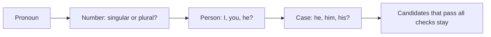

**In simple words:** a pronoun can refer only to a noun that agrees with it. Agreement rules remove impossible candidates. *(The class files do not cover this question; the answer is short and standard.)*

**1. Number agreement:** a singular pronoun needs a singular antecedent and a plural pronoun needs a plural one. "The **chefs** made lunch. **She** served it." is wrong, because *She* is singular and *chefs* is plural. With *they*, *chefs* works.

**2. Person and case agreement:**

- **Person:** first (I, we), second (you) and third person (he, she, it, they) must match. In "**Ram** said that **he** was late", *he* is third person and fits Ram.
- **Case:** the pronoun form shows its job: *he* (subject), *him* (object), *his* (owner). In "Ram saw **him**", *him* is not Ram.

| Check | Pronoun | Fits | Does not fit |
|---|---|---|---|
| Number | she | one woman | the chefs |
| Person | he | Ram (third person) | you |
| Case | him (object) | someone other than the subject | the subject itself |

**Conclusion:** constraints cut the candidates down; preferences decide the rest.
