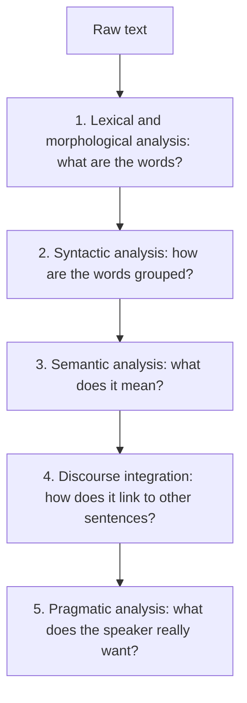
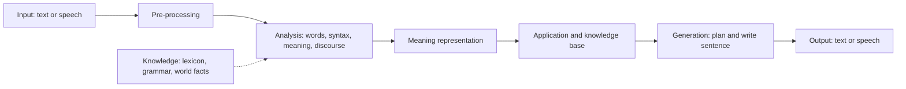

**In simple words:** sentence samajhne ke liye NLP system kai levels (stages) se guzarta hai. Har stage same text ke baare mein ek naya sawaal poochta hai. **Generic NLP system** poora block diagram hai jo input leta hai, use samajhta hai, task karta hai aur reply likhta hai. <Cite id="nlp-introduction-gfg-phases" /> <Cite id="nlp-introduction-tp-nlp" />

**Part 1: Stages of NLP**

<Cite id="nlp-introduction-gfg-phases" loc="diagram" />

| Stage | Job | Example: "The bank approved the loan." |
|---|---|---|
| 1. Lexical and morphological | Words todna, stems aur word classes nikalna | `the`, `bank`, `approve` + `-ed`, `the`, `loan` |
| 2. Syntactic | Grammar check, parse tree banana | [S [NP the bank] [VP approved [NP the loan]]] |
| 3. Semantic | Literal meaning, word senses chunna | approve(bank, loan); *bank* = money institution |
| 4. Discourse | Pehle ya baad ke sentences se jodna | "It carries 8% interest" mein *It* = the loan |
| 5. Pragmatic | Context mein asli iraada samajhna | "Can you pass the salt?" ek request hai, ability ka sawaal nahi |

**Part 2: Generic NLP system**

1. **Input:** text, ya speech jo speech recognition se text banti hai.
2. **Pre-processing:** sentence aur word splitting, clean-up.
3. **Analysis (understanding, NLU):** upar ke pehle chaar stages.
4. **Meaning representation:** result slots ya logic mein store hota hai, jaise action=find, place=Pune.
5. **Application:** asli task (answer, translate, search), knowledge base ke saath.
6. **Generation (NLG):** kya kehna hai plan karo aur sahi sentence likho.
7. **Output:** text ya synthesized speech.

<Cite id="nlp-introduction-nltk1" loc="diagram" />

**Advantages:** stages har part ko simple aur replaceable rakhte hain. **Limitation:** early stage ki galti aage ke har stage mein phail jaati hai.

**Conclusion:** NLP words se intention tak paanch levels mein kaam karta hai, aur generic system unhe input aur output ke beech rakhta hai.

Exam mein English mein likho: "The stages of NLP are lexical, syntactic, semantic, discourse and pragmatic analysis."
