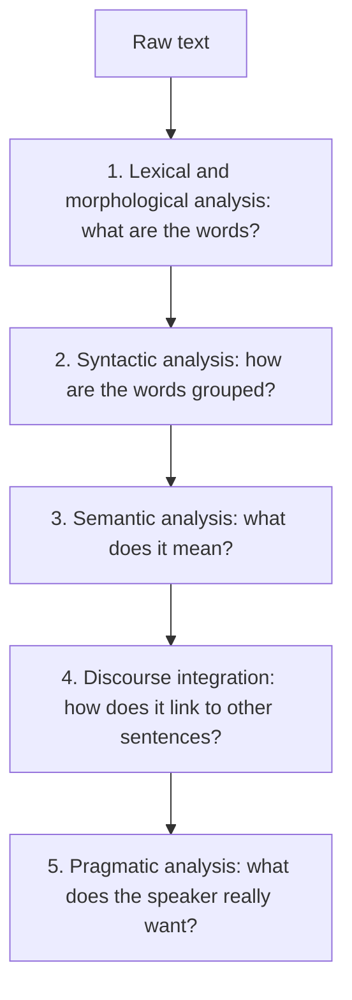
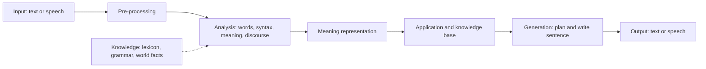

**In simple words:** to understand a sentence, an NLP system goes through levels (stages). Each stage asks a new question about the same text. A **generic NLP system** is the full block diagram that takes input, understands it, does the task and writes a reply. <Cite id="nlp-introduction-gfg-phases" /> <Cite id="nlp-introduction-tp-nlp" />

**Part 1: Stages of NLP**

<Cite id="nlp-introduction-gfg-phases" loc="diagram" />

| Stage | Job | Example: "The bank approved the loan." |
|---|---|---|
| 1. Lexical and morphological | Split into words, find stems and word classes | `the`, `bank`, `approve` + `-ed`, `the`, `loan` |
| 2. Syntactic | Check grammar, build a parse tree | [S [NP the bank] [VP approved [NP the loan]]] |
| 3. Semantic | Find the literal meaning, pick word senses | approve(bank, loan); *bank* = money institution |
| 4. Discourse | Link to earlier or later sentences | in "It carries 8% interest", *It* = the loan |
| 5. Pragmatic | Read the real intention in context | "Can you pass the salt?" is a request, not a question about ability |

**Part 2: Generic NLP system**

1. **Input:** text, or speech turned into text by speech recognition.
2. **Pre-processing:** sentence and word splitting, clean-up.
3. **Analysis (understanding, NLU):** the first four stages above.
4. **Meaning representation:** the result stored as slots or logic, for example action=find, place=Pune.
5. **Application:** the real task (answer, translate, search) using a knowledge base.
6. **Generation (NLG):** plan what to say and write a correct sentence.
7. **Output:** text or synthesized speech.

<Cite id="nlp-introduction-nltk1" loc="diagram" />

**Advantages:** stages keep each part simple and replaceable. **Limitation:** an error in an early stage spreads to every later stage.

**Conclusion:** NLP works in five levels, from words to intention, and a generic system wraps them between input and output.
