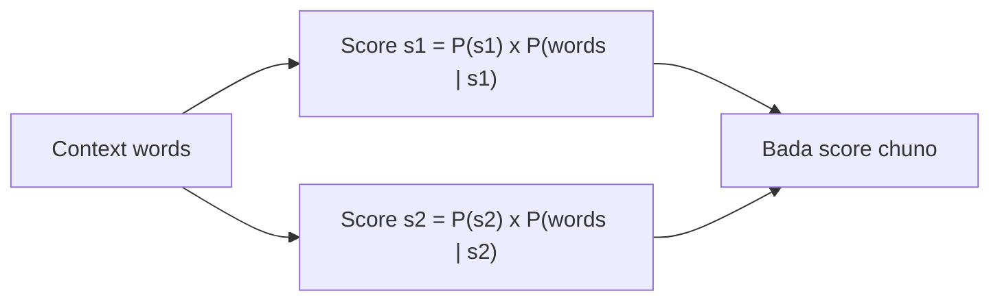

**In simple words:** WSD isliye chahiye kyunki ek word ke kai meanings ho sakte hain, aur Naive Bayes wo meaning chunta hai jo aas-paas ke words ko dekhte hue sabse probable ho.

**(i) WSD ki zaroorat:** bahut se words ambiguous hote hain, isliye context ke saath meaning badalti hai ("deposited money in the bank" versus "the river bank"). WSD NLP system ko aas-paas ke words analyze karke intended sense dhundhne deta hai, jisse language understanding behtar hoti hai aur ambiguity kam hoti hai. <Cite id="class-nlp-pyq4" loc="p. 5" />

**(ii) Naive Bayes supervised algorithm** *(class files mein Naive Bayes nahi hai; ye standard short explanation hai)*

Ye supervised method hai: ye un sentences se seekhta hai jinme sense pehle se mark hai. Senses $s_1, s_2, \ldots$ wale word aur context words $c_1, c_2, \ldots, c_n$ ke liye ye wo sense chunta hai

$$
\hat{s} = \arg\max_{s} \; P(s) \prod_{j=1}^{n} P(c_j \mid s)
$$

$P(s)$ batata hai ki training data mein sense kitni baar aata hai, aur $P(c_j \mid s)$ batata hai ki context word $c_j$ us sense ke saath kitni baar aata hai. "Naive" ka matlab hai ki context words ko ek doosre se independent maana jaata hai. Dono counting se milte hain.

<Sum>

<Given>

word *bank* ke senses s1 (finance) aur s2 (river). Labelled corpus se: $P(s_1) = 0.6$, $P(s_2) = 0.4$; $P(\text{money} \mid s_1) = 0.3$, $P(\text{money} \mid s_2) = 0.05$; $P(\text{deposit} \mid s_1) = 0.2$, $P(\text{deposit} \mid s_2) = 0.02$. Context: *money*, *deposit*.

</Given>

<Find>

*bank* ka sense.

</Find>

<Steps>

1. s1 ka score $= 0.6 \times 0.3 \times 0.2 = 0.036$.
2. s2 ka score $= 0.4 \times 0.05 \times 0.02 = 0.0004$.
3. Compare: $0.036 > 0.0004$, isliye s1 chuno.

</Steps>

<Answer>

*bank* = finance sense (s1).

</Answer>

<Box kind="verify">

Normalize karo: $0.036 / (0.036 + 0.0004) = 0.989$, yaani s1 ki probability lagbhag 99 percent hai, aur dono probabilities ka sum 1 hai. Context words *money* aur *deposit* finance sense ke saath bahut zyaada common hain, isliye answer samajh mein aata hai.

</Box>

</Sum>

**Advantage:** simple aur tez. **Disadvantage:** sense-labelled corpus chahiye, aur independence assumption poori tarah sach nahi.

**Conclusion:** Naive Bayes sabse bada $P(s) \prod P(c_j \mid s)$ wala sense chunta hai.
