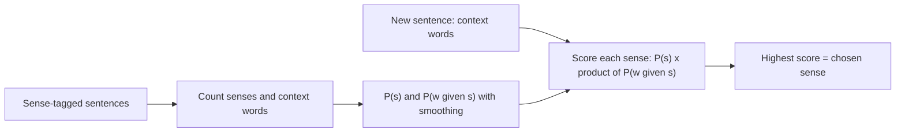

**In simple words:** bahut se words ke ek se zyada meaning hote hain (*bank* = paise ki jagah ya nadi ka kinara). **Word sense disambiguation (WSD)** wo meaning chunta hai jo sentence mein fit hota hai. <Cite id="word-sense-disambiguation-slp3-I" loc="§I.4" /> <Cite id="word-sense-disambiguation-gfg-wsd" />

**i) WSD ki zaroorat kyun**

- **Machine translation:** *bank* ke do senses ke liye Hindi mein alag words hain, galat sense se galat translation aata hai.
- **Search aur question answering:** "bass fishing" ke liye music pages nahi aane chahiye.
- **Text-to-speech aur classification:** *bass* do tarah se padha jaata hai; sense se topic bhi decide hota hai.
- **Chatbots aur information extraction** ko sahi action ke liye sahi meaning chahiye. <Cite id="word-sense-disambiguation-tp-wsd" />

**ii) Naive Bayes supervised algorithm**

*Idea:* un sentences se seekho jinpe sahi sense pehle se laga hai, aur paas ke words ko clue ki tarah use karo. Wo sense $s$ chuno jiska score sabse zyada ho:

$$\hat{s} = \arg\max_s \; P(s) \prod_{j} P(w_j \mid s)$$

$P(s)$ batata hai sense kitna common hai (prior). $P(w_j \mid s)$ batata hai context word $w_j$ us sense ke saath kitni baar aata hai (likelihood). "Naive" matlab sense pata hone par context words ko independent maante hain. Add-one smoothing: $P(w \mid s) = \frac{C(w,s)+1}{N_s + |V|}$, jahan $N_s$ sense $s$ ke total words aur $|V|$ vocabulary size hai. <Cite id="word-sense-disambiguation-slp3-B" />

<Sum>

<Given>

Word *bank*, practice ke liye banaye hue counts: 6 money-sense (FIN) aur 4 river-sense (RIV) training sentences; $|V| = 6$. Word counts: FIN mein money 5, water 1, river 0 (total 13); RIV mein money 1, water 3, river 4 (total 10). Context: *river, water, money*.

</Given>

<Find>

*bank* ka sense.

</Find>

<Steps>

1. Priors: $P(FIN) = 0.6$, $P(RIV) = 0.4$.
2. FIN: $\frac{1}{19} \cdot \frac{2}{19} \cdot \frac{6}{19} = \frac{12}{6859}$, 0.6 se multiply karne par $0.00105$.
3. RIV: $\frac{5}{16} \cdot \frac{4}{16} \cdot \frac{2}{16} = \frac{40}{4096}$, 0.4 se multiply karne par $0.00391$.
4. $0.00391 > 0.00105$, to RIV chuno.

</Steps>

<Answer>

*bank* = river side (RIV).

</Answer>

<Box kind="verify">

Smoothing ke bina FIN 0 hota kyunki `river` FIN ke saath kabhi nahi aaya; smoothing se wo chhota rehta hai par 0 nahi. RIV isliye jeetta hai kyunki teen mein se do clues (river, water) uske hain.

</Box>

</Sum>

**Advantages:** simple, fast, kaafi data ho to accurate. **Disadvantage:** sense-tagged data banana mehenga hai, aur independence assumption sach nahi hota. <Cite id="word-sense-disambiguation-gfg-wsd" />

**Conclusion:** sahi translation aur search ke liye WSD zaroori hai; Naive Bayes wo sense chunta hai jiska prior times likelihood sabse bada ho.

Exam mein English mein likho: "Naive Bayes picks the sense that maximises P(s) times the product of P(w | s) over the context words."
