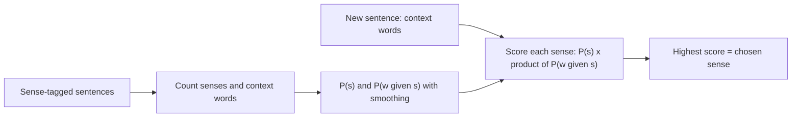

**In simple words:** many words have more than one meaning (*bank* = money place or river side). **Word sense disambiguation (WSD)** picks the meaning that fits the sentence. <Cite id="word-sense-disambiguation-slp3-I" loc="§I.4" /> <Cite id="word-sense-disambiguation-gfg-wsd" />

**i) Why WSD is needed**

- **Machine translation:** *bank* has different words in Hindi for the two senses, so the wrong sense gives a wrong translation.
- **Search and question answering:** "bass fishing" must not return music pages.
- **Text-to-speech and classification:** *bass* is read in two ways; the sense also decides the topic.
- **Chatbots and information extraction** need the right meaning to act correctly. <Cite id="word-sense-disambiguation-tp-wsd" />

**ii) Naive Bayes supervised algorithm**

*Idea:* learn from sentences already labelled with the right sense, and use the neighbouring words as clues. Pick the sense $s$ with the highest

$$\hat{s} = \arg\max_s \; P(s) \prod_{j} P(w_j \mid s)$$

$P(s)$ is how common the sense is (prior). $P(w_j \mid s)$ is how often context word $w_j$ appears with that sense (likelihood). "Naive" means the context words are treated as independent given the sense. Add-one smoothing: $P(w \mid s) = \frac{C(w,s)+1}{N_s + |V|}$, where $N_s$ is the total word count of sense $s$ and $|V|$ the vocabulary size. <Cite id="word-sense-disambiguation-slp3-B" />

<Sum>

<Given>

Word *bank*, with made-up practice counts: 6 money-sense (FIN) and 4 river-sense (RIV) training sentences; $|V| = 6$. Word counts: FIN has money 5, water 1, river 0 (total 13); RIV has money 1, water 3, river 4 (total 10). Context: *river, water, money*.

</Given>

<Find>

the sense of *bank*.

</Find>

<Steps>

1. Priors: $P(FIN) = 0.6$, $P(RIV) = 0.4$.
2. FIN: $\frac{1}{19} \cdot \frac{2}{19} \cdot \frac{6}{19} = \frac{12}{6859}$, times 0.6 gives $0.00105$.
3. RIV: $\frac{5}{16} \cdot \frac{4}{16} \cdot \frac{2}{16} = \frac{40}{4096}$, times 0.4 gives $0.00391$.
4. $0.00391 > 0.00105$, so choose RIV.

</Steps>

<Answer>

*bank* = river side (RIV).

</Answer>

<Box kind="verify">

Without smoothing FIN would be 0 because `river` never occurred with FIN; with smoothing it stays small but not zero. RIV wins because two of the three clues (river, water) belong to it.

</Box>

</Sum>

**Advantages:** simple, fast, accurate with enough data. **Disadvantage:** needs costly sense-tagged data, and the independence assumption is not true. <Cite id="word-sense-disambiguation-gfg-wsd" />

**Conclusion:** WSD is needed for correct translation and search; Naive Bayes chooses the sense with the largest prior times likelihood.
