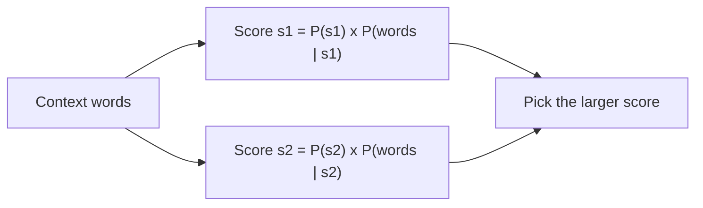

**In simple words:** WSD is needed because one word can have several meanings, and Naive Bayes picks the meaning that is most probable given the words around it.

**(i) Need of WSD:** many words are ambiguous, so their meaning changes with the context ("deposited money in the bank" versus "the river bank"). WSD lets an NLP system analyze the surrounding words and find the intended sense, which improves language understanding and reduces ambiguity. <Cite id="class-nlp-pyq4" loc="p. 5" />

**(ii) Naive Bayes supervised algorithm** *(the class files do not cover Naive Bayes; this is the standard short explanation)*

It is a supervised method: it learns from sentences in which the sense is already marked. For a word with senses $s_1, s_2, \ldots$ and context words $c_1, c_2, \ldots, c_n$ it chooses the sense

$$
\hat{s} = \arg\max_{s} \; P(s) \prod_{j=1}^{n} P(c_j \mid s)
$$

$P(s)$ is how often the sense occurs in the training data, and $P(c_j \mid s)$ is how often the context word $c_j$ appears with that sense. "Naive" means that the context words are treated as independent of each other. Both are found by counting.

<Sum>

<Given>

word *bank* with senses s1 (finance) and s2 (river). From a labelled corpus: $P(s_1) = 0.6$, $P(s_2) = 0.4$; $P(\text{money} \mid s_1) = 0.3$, $P(\text{money} \mid s_2) = 0.05$; $P(\text{deposit} \mid s_1) = 0.2$, $P(\text{deposit} \mid s_2) = 0.02$. Context: *money*, *deposit*.

</Given>

<Find>

the sense of *bank*.

</Find>

<Steps>

1. Score for s1 $= 0.6 \times 0.3 \times 0.2 = 0.036$.
2. Score for s2 $= 0.4 \times 0.05 \times 0.02 = 0.0004$.
3. Compare: $0.036 > 0.0004$, so choose s1.

</Steps>

<Answer>

*bank* = finance sense (s1).

</Answer>

<Box kind="verify">

Normalize: $0.036 / (0.036 + 0.0004) = 0.989$, so s1 has about 99 percent probability, and the two probabilities add to 1. The context words *money* and *deposit* are far more common with the finance sense, so the answer makes sense.

</Box>

</Sum>

**Advantage:** simple and fast. **Disadvantage:** needs a sense-labelled corpus, and the independence assumption is not strictly true.

**Conclusion:** Naive Bayes chooses the sense with the highest $P(s) \prod P(c_j \mid s)$.
