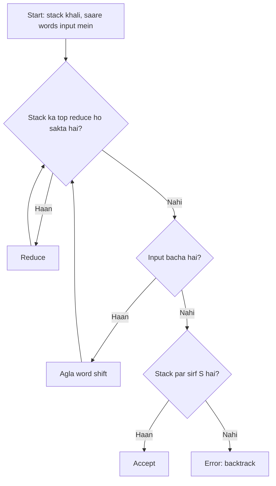

**In simple words:** shift-reduce parser ek bottom-up parser hai. Ye words ko left se right padhta hai, stack par rakhta hai, aur jab stack ka top kisi rule ke right side se match kare to use left side se badal deta hai. Agar end mein stack par sirf S bache to sentence accept hota hai. <Cite id="class-nlp-pyq3" loc="p. 6" />

Bottom-up parsing input string ko grammar ke start symbol tak reduce karne ki koshish karti hai (rightmost derivation, ulta). Shift-reduce parser class mein bottom-up parser ka example hai. <Cite id="class-nlp-pyq3" loc="p. 6" />

*(Class files parser ka naam batati hain par steps nahi; neeche ka trace standard method hai.)*

**Parts:** ek **stack**, bache hue words wala **input buffer**, aur chaar actions:

1. **Shift:** input se agla word stack par le aao.
2. **Reduce:** stack ke top par rule ke right side ko uske left side se badlo.
3. **Accept:** stack par sirf S hai aur input khatam.
4. **Error / backtrack:** koi action kaam nahi karta; peeche jaakar doosra choice try karo.

**Example.** Grammar: S → NP VP, NP → Det N | N, VP → V NP, Det → The | this, N → man | book, V → read (class grammar). Sentence: "The man read this book". <Cite id="class-nlp-pyq3" loc="p. 8" />

| Step | Stack | Remaining input | Action |
|---|---|---|---|
| 1 | | The man read this book | Shift |
| 2 | The | man read this book | Reduce Det → The |
| 3 | Det | man read this book | Shift |
| 4 | Det man | read this book | Reduce N → man |
| 5 | Det N | read this book | Reduce NP → Det N |
| 6 | NP | read this book | Shift |
| 7 | NP read | this book | Reduce V → read |
| 8 | NP V | this book | Shift |
| 9 | NP V this | book | Reduce Det → this |
| 10 | NP V Det | book | Shift |
| 11 | NP V Det book | | Reduce N → book |
| 12 | NP V Det N | | Reduce NP → Det N |
| 13 | NP V NP | | Reduce VP → V NP |
| 14 | NP VP | | Reduce S → NP VP |
| 15 | S | | Accept |

**Conflicts:** step 5 par top symbol N ko akele NP → N se bhi reduce kiya ja sakta tha, jisse Det NP bachta, jise koi rule reduce nahi kar sakta. Tab parser ko backtrack karna padta hai ya look-ahead use karna padta hai. Actions ke beech chunna shift-reduce parsing ki main mushkil hai.

**Advantage:** simple, tez, words se bottom-up kaam karta hai. **Disadvantage:** actions ke beech conflicts.

**Conclusion:** shift-reduce words ko shift aur reduce karke tab tak parse karta hai jab tak sirf S na bache.
