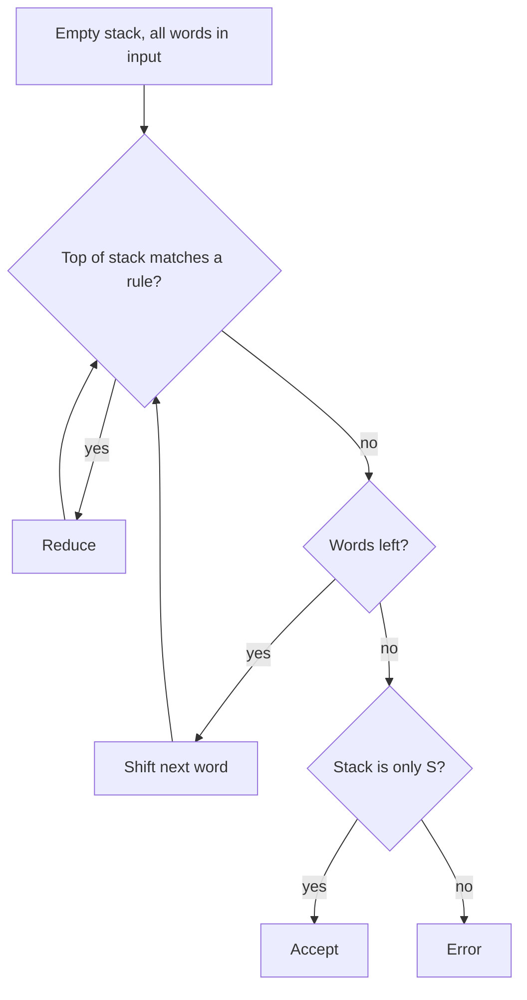

**In simple words:** shift-reduce parser ek **bottom-up** parser hai. Wo words ko left se right padhta hai, ek **stack** rakhta hai, aur words se upar S tak parse tree banata hai. <Cite id="cfg-parsing-wiki-sr" /> <Cite id="cfg-parsing-gfg-sr" /> <Cite id="ambiguity-challenges-nltk-ch8" loc="§4.2" />

**Parts:** ek stack (shuru mein khali), ek input buffer (sentence), aur ek grammar.

**Actions:**

1. **Shift:** input ka agla word stack pe daalo.
2. **Reduce:** agar stack ka top kisi rule ki right side se match kare, to use left side se badal do.
3. **Accept:** input khatam aur stack mein sirf S.
4. **Error:** na shift ho sakta hai na reduce.

<Cite id="cfg-parsing-gfg-sr" loc="diagram" />

**Example.** Grammar: S → NP VP, NP → Det NOM, NOM → Noun, VP → Verb NP, Det → the | this, Noun → man | book, Verb → read. Sentence: *the man read this book*.

| Step | Stack | Input left | Action |
|---|---|---|---|
| 1 | (empty) | the man read this book | shift |
| 2 | the | man read this book | reduce Det → the |
| 3 | Det | man read this book | shift |
| 4 | Det man | read this book | reduce Noun → man |
| 5 | Det Noun | read this book | reduce NOM → Noun |
| 6 | Det NOM | read this book | reduce NP → Det NOM |
| 7 | NP | read this book | shift |
| 8 | NP read | this book | reduce Verb → read |
| 9 | NP Verb | this book | shift |
| 10 | NP Verb this | book | reduce Det → this |
| 11 | NP Verb Det | book | shift |
| 12 | NP Verb Det book | (empty) | reduce Noun → book |
| 13 | NP Verb Det Noun | (empty) | reduce NOM → Noun |
| 14 | NP Verb Det NOM | (empty) | reduce NP → Det NOM |
| 15 | NP Verb NP | (empty) | reduce VP → Verb NP |
| 16 | NP VP | (empty) | reduce S → NP VP |
| 17 | S | (empty) | accept |

Sentence 17 steps mein accept hua: 5 shifts, 11 reduces, 1 accept. 11 reduces parse tree ke 11 non-word nodes (S, NP, VP, Det, NOM, Noun, Verb wagairah) banate hain.

**Conflicts aur limits:** agar grammar mein VP → Verb bhi hota, to step 9 pe reduce ya shift dono possible hote (shift-reduce conflict), aur do rules ek hi top se match ho sakte hain (reduce-reduce conflict). Basic parser ek choice leta hai aur **kabhi backtrack nahi karta**, to valid parse miss kar sakta hai. Real parsers lookahead table ya trained classifier use karte hain.

| Advantages | Disadvantages |
|---|---|
| Ek pass, fast, kam memory | Conflicts, backtracking nahi |
| Stack se implement karna easy | Sirf ek parse deta hai |

**Conclusion:** shift-reduce parsing words ko shift karke aur grammar rules se reduce karke bottom-up tree banata hai jab tak S na bache.

Exam mein English mein likho: "A shift-reduce parser uses a stack and repeats shift and reduce until only S remains."
