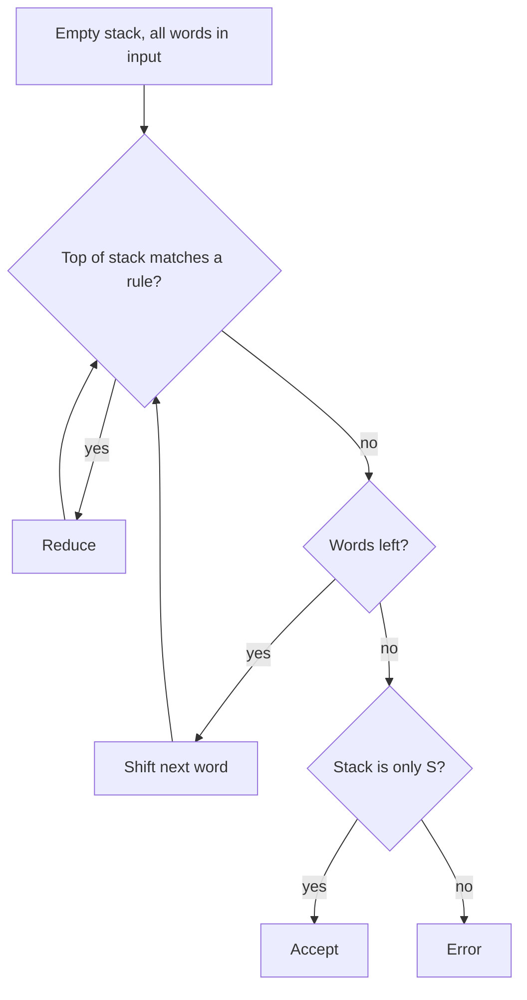

**In simple words:** a shift-reduce parser is a **bottom-up** parser. It reads the words left to right, keeps a **stack**, and builds the parse tree from the words up to S. <Cite id="cfg-parsing-wiki-sr" /> <Cite id="cfg-parsing-gfg-sr" /> <Cite id="ambiguity-challenges-nltk-ch8" loc="§4.2" />

**Parts:** a stack (starts empty), an input buffer (the sentence), and a grammar.

**Actions:**

1. **Shift:** move the next word from the input to the stack.
2. **Reduce:** if the top of the stack matches the right side of a rule, replace it with the left side.
3. **Accept:** input empty and the stack is only S.
4. **Error:** neither shift nor reduce is possible.

<Cite id="cfg-parsing-gfg-sr" loc="diagram" />

**Example.** Grammar: S → NP VP, NP → Det NOM, NOM → Noun, VP → Verb NP, Det → the | this, Noun → man | book, Verb → read. Sentence: *the man read this book*.

| Step | Stack | Input left | Action |
|---|---|---|---|
| 1 | (empty) | the man read this book | shift |
| 2 | the | man read this book | reduce Det → the |
| 3 | Det | man read this book | shift |
| 4 | Det man | read this book | reduce Noun → man |
| 5 | Det Noun | read this book | reduce NOM → Noun |
| 6 | Det NOM | read this book | reduce NP → Det NOM |
| 7 | NP | read this book | shift |
| 8 | NP read | this book | reduce Verb → read |
| 9 | NP Verb | this book | shift |
| 10 | NP Verb this | book | reduce Det → this |
| 11 | NP Verb Det | book | shift |
| 12 | NP Verb Det book | (empty) | reduce Noun → book |
| 13 | NP Verb Det Noun | (empty) | reduce NOM → Noun |
| 14 | NP Verb Det NOM | (empty) | reduce NP → Det NOM |
| 15 | NP Verb NP | (empty) | reduce VP → Verb NP |
| 16 | NP VP | (empty) | reduce S → NP VP |
| 17 | S | (empty) | accept |

The sentence is accepted in 17 steps: 5 shifts, 11 reduces, 1 accept. The 11 reduces build the 11 non-word nodes of the parse tree (S, NP, VP, Det, NOM, Noun, Verb and so on).

**Conflicts and limits:** if the grammar also had VP → Verb, step 9 would allow reduce or shift (shift-reduce conflict), and two rules may match the same top (reduce-reduce conflict). The basic parser picks one choice and **never backtracks**, so it can miss a valid parse. Real parsers use lookahead tables or a trained classifier.

| Advantages | Disadvantages |
|---|---|
| One pass, fast, small memory | Conflicts, no backtracking |
| Easy to implement with a stack | Gives only one parse |

**Conclusion:** shift-reduce parsing builds the tree bottom-up by shifting words and reducing them by grammar rules until S remains.
