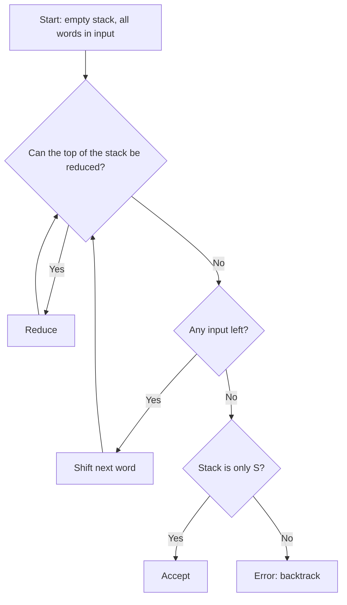

**In simple words:** a shift-reduce parser is a bottom-up parser. It reads the words from left to right, puts them on a stack, and whenever the top of the stack matches the right side of a rule, it replaces it by the left side. If it ends with only S on the stack, the sentence is accepted. <Cite id="class-nlp-pyq3" loc="p. 6" />

Bottom-up parsing tries to reduce the input string to the start symbol of the grammar (rightmost derivation, in reverse). The shift-reduce parser is the class example of a bottom-up parser. <Cite id="class-nlp-pyq3" loc="p. 6" />

*(The class files name the parser but give no steps; the trace below is the standard method.)*

**Parts:** a **stack**, an **input buffer** with the remaining words, and four actions:

1. **Shift:** move the next word from the input onto the stack.
2. **Reduce:** replace the right side of a rule on top of the stack by its left side.
3. **Accept:** the stack holds only S and the input is empty.
4. **Error / backtrack:** no action works; go back and try another choice.

**Example.** Grammar: S → NP VP, NP → Det N | N, VP → V NP, Det → The | this, N → man | book, V → read (the class grammar). Sentence: "The man read this book". <Cite id="class-nlp-pyq3" loc="p. 8" />

| Step | Stack | Remaining input | Action |
|---|---|---|---|
| 1 | | The man read this book | Shift |
| 2 | The | man read this book | Reduce Det → The |
| 3 | Det | man read this book | Shift |
| 4 | Det man | read this book | Reduce N → man |
| 5 | Det N | read this book | Reduce NP → Det N |
| 6 | NP | read this book | Shift |
| 7 | NP read | this book | Reduce V → read |
| 8 | NP V | this book | Shift |
| 9 | NP V this | book | Reduce Det → this |
| 10 | NP V Det | book | Shift |
| 11 | NP V Det book | | Reduce N → book |
| 12 | NP V Det N | | Reduce NP → Det N |
| 13 | NP V NP | | Reduce VP → V NP |
| 14 | NP VP | | Reduce S → NP VP |
| 15 | S | | Accept |

**Conflicts:** at step 5 the top symbol N could also be reduced alone by NP → N, leaving Det NP, which no rule can reduce. The parser must then backtrack or use a look-ahead. Choosing between actions is the main difficulty of shift-reduce parsing.

**Advantage:** simple, fast, works bottom-up from the words. **Disadvantage:** conflicts between actions.

**Conclusion:** shift-reduce parses by shifting words and reducing them until only S is left.
