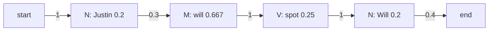

**In simple words:** HMM tagger ko counting se seekhe do tables chahiye: **transition** probabilities (tag se agla tag) aur **emission** probabilities (tag se word). Phir **Viterbi** algorithm best tag sequence nikalta hai. `Will`/`will` aur `Spot`/`spot` ko main same word (lower-case) maanta hoon. <Cite id="pos-tagging-gfg-hmm" /> <Cite id="hmm-maxent-crf-slp3-appA" /> <Cite id="pos-tagging-iiith-hmm" />

<Sum>

<Given>

Chaar tagged sentences: Martin/N Justin/N can/M watch/V Will/N; Spot/N will/M watch/V Martin/N; Will/N Justin/N spot/V Martin/N; Martin/N will/M pat/V Spot/N. Tags: N noun, M modal, V verb. Test sentence: *Justin will spot Will*.

</Given>

<Find>

transition matrix, emission matrix, aur sentence ke best tags.

</Find>

<Steps>

1. **Tag counts.** N = 10, M = 3, V = 4 (17 words). *Reason: ye denominators hain.*
2. **Transitions** $P(t_i \mid t_{i-1}) = C(t_{i-1}, t_i) / C(t_{i-1})$. Har sentence N se shuru aur N pe khatam hota hai. N se nikalne wale counts: N 2, M 3, V 1, end 4 (total 10). M se: V 3. V se: N 4.

| From \ To | N | M | V | `<E>` |
|---|---|---|---|---|
| `<S>` | 1 | 0 | 0 | 0 |
| N | 2/10 = 0.2 | 3/10 = 0.3 | 1/10 = 0.1 | 4/10 = 0.4 |
| M | 0 | 0 | 1 | 0 |
| V | 1 | 0 | 0 | 0 |

3. **Emissions** $P(w \mid t) = C(t, w) / C(t)$:

| Tag | Martin | Justin | will | spot | pat | can | watch |
|---|---|---|---|---|---|---|---|
| N | 4/10 = 0.4 | 0.2 | 0.2 | 0.2 | 0 | 0 | 0 |
| M | 0 | 0 | 2/3 | 0 | 0 | 1/3 | 0 |
| V | 0 | 0 | 0 | 1/4 | 1/4 | 0 | 2/4 = 0.5 |

4. **Viterbi trellis.** Har cell us tag pe khatam hone wale best path ki probability hai; `Justin` sirf N ho sakta hai.

| Tag | Justin | will | spot | Will |
|---|---|---|---|---|
| N | $1 \times 0.2 = 0.2$ | $0.2 \times 0.2 \times 0.2 = 0.008$ | $0.008 \times 0.2 \times 0.2 = 0.00032$ | $0.01 \times 1 \times 0.2 = 0.002$ (V se) |
| M | 0 | $0.2 \times 0.3 \times \frac23 = 0.04$ | 0 | $0.00032 \times 0.3 \times \frac23 = 0.000064$ |
| V | 0 | 0 | $0.04 \times 1 \times 0.25 = 0.01$ (M se) | 0 |

5. **End.** N se `<E>`: $0.002 \times 0.4 = 0.0008$. M se `<E>` 0 hai. Peeche trace karo: Will V se aaya, spot M se, will N se.

</Steps>

<Answer>

*Justin/N will/M spot/V Will/N*, probability 0.0008 ke saath.

</Answer>

<Box kind="verify">

Poora path seedha multiply karo: $1 \times 0.2 \times 0.3 \times \frac23 \times 1 \times 0.25 \times 1 \times 0.2 \times 0.4 = 0.0008$. Rival path N N V N ka $0.000016$ aata hai, bahut chhota, aur answer natural lagta hai (Justin naam hai, will modal hai, spot verb hai).

</Box>

</Sum>

<Cite id="pos-tagging-wiki-viterbi" loc="diagram" />

**Conclusion:** counting se do matrices milte hain; Viterbi tag sequence N M V N chunta hai, probability 0.0008.

Exam mein English mein likho: "Transition probability is the count of a tag pair over the count of the first tag; emission probability is the count of a word with a tag over the count of the tag."
