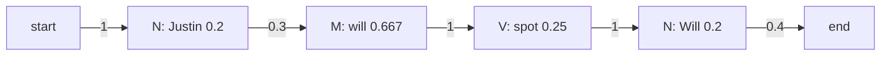

**In simple words:** an HMM tagger needs two tables learned by counting: **transition** probabilities (tag to next tag) and **emission** probabilities (tag to word). The **Viterbi** algorithm then finds the best tag sequence. I treat `Will`/`will` and `Spot`/`spot` as the same word (lower-case). <Cite id="pos-tagging-gfg-hmm" /> <Cite id="hmm-maxent-crf-slp3-appA" /> <Cite id="pos-tagging-iiith-hmm" />

<Sum>

<Given>

Four tagged sentences: Martin/N Justin/N can/M watch/V Will/N; Spot/N will/M watch/V Martin/N; Will/N Justin/N spot/V Martin/N; Martin/N will/M pat/V Spot/N. Tags: N noun, M modal, V verb. Test sentence: *Justin will spot Will*.

</Given>

<Find>

the transition matrix, the emission matrix, and the best tags for the sentence.

</Find>

<Steps>

1. **Tag counts.** N = 10, M = 3, V = 4 (17 words). *Reason: these are the denominators.*
2. **Transitions** $P(t_i \mid t_{i-1}) = C(t_{i-1}, t_i) / C(t_{i-1})$. Every sentence starts with N and ends with N. Counts leaving N: N 2, M 3, V 1, end 4 (total 10). Leaving M: V 3. Leaving V: N 4.

| From \ To | N | M | V | `<E>` |
|---|---|---|---|---|
| `<S>` | 1 | 0 | 0 | 0 |
| N | 2/10 = 0.2 | 3/10 = 0.3 | 1/10 = 0.1 | 4/10 = 0.4 |
| M | 0 | 0 | 1 | 0 |
| V | 1 | 0 | 0 | 0 |

3. **Emissions** $P(w \mid t) = C(t, w) / C(t)$:

| Tag | Martin | Justin | will | spot | pat | can | watch |
|---|---|---|---|---|---|---|---|
| N | 4/10 = 0.4 | 0.2 | 0.2 | 0.2 | 0 | 0 | 0 |
| M | 0 | 0 | 2/3 | 0 | 0 | 1/3 | 0 |
| V | 0 | 0 | 0 | 1/4 | 1/4 | 0 | 2/4 = 0.5 |

4. **Viterbi trellis.** Each cell is the best path probability ending in that tag; `Justin` can only be N.

| Tag | Justin | will | spot | Will |
|---|---|---|---|---|
| N | $1 \times 0.2 = 0.2$ | $0.2 \times 0.2 \times 0.2 = 0.008$ | $0.008 \times 0.2 \times 0.2 = 0.00032$ | $0.01 \times 1 \times 0.2 = 0.002$ (from V) |
| M | 0 | $0.2 \times 0.3 \times \frac23 = 0.04$ | 0 | $0.00032 \times 0.3 \times \frac23 = 0.000064$ |
| V | 0 | 0 | $0.04 \times 1 \times 0.25 = 0.01$ (from M) | 0 |

5. **End.** N to `<E>`: $0.002 \times 0.4 = 0.0008$. M to `<E>` is 0. Trace back: Will from V, spot from M, will from N.

</Steps>

<Answer>

*Justin/N will/M spot/V Will/N*, with probability 0.0008.

</Answer>

<Box kind="verify">

Multiply the whole path directly: $1 \times 0.2 \times 0.3 \times \frac23 \times 1 \times 0.25 \times 1 \times 0.2 \times 0.4 = 0.0008$. A rival path N N V N gives $0.000016$, much smaller, and the answer reads naturally (Justin is a name, will is a modal, spot is a verb).

</Box>

</Sum>

<Cite id="pos-tagging-wiki-viterbi" loc="diagram" />

**Conclusion:** counting gives the two matrices; Viterbi picks the tag sequence N M V N with probability 0.0008.
