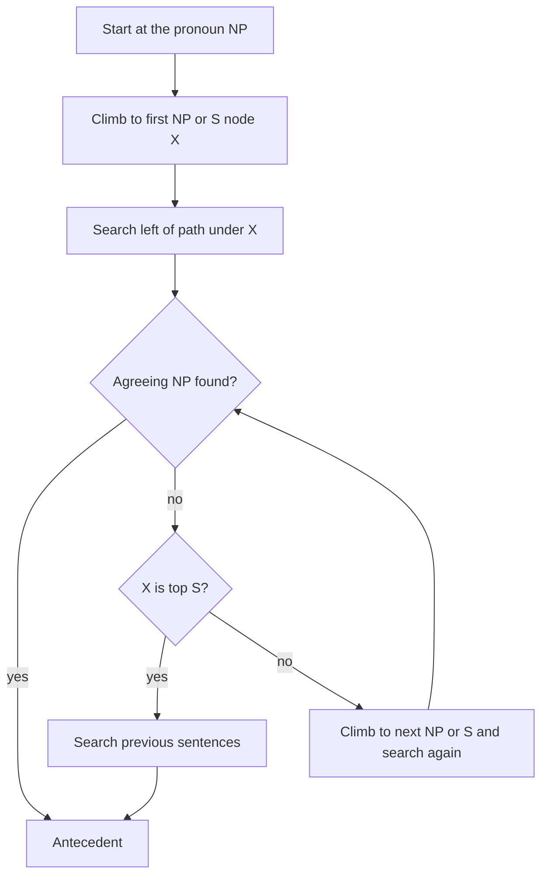

**In simple words:** **anaphora resolution** pata lagata hai ki pronoun (*she*, *it*) pehle ke kaun se phrase (antecedent) ko point karta hai. Hobbs ye parse tree mein search karke karta hai. Centering discourse ka topic smooth rakhkar karta hai. <Cite id="anaphora-resolution-tp-nlp" />

**1) Hobbs' algorithm (1978).** Ye sentence ke parse tree mein, phir pehle ke sentences mein, ek fixed order mein chalta hai aur pehla noun phrase (NP) accept karta hai jo pronoun se number, gender aur person mein agree kare. <Cite id="anaphora-resolution-hobbs1978" />

1. Pronoun ke NP node se shuru karo.
2. Upar jaakar pehle NP ya S node X tak pahuncho.
3. X ke neeche path ke left mein, left se right, breadth-first search karo. Jo NP mile aur jiske aur X ke beech NP ya S ho, use propose karo.
4. Agar X sabse upar ka S hai, to pichle sentences mein search karo, sabse recent pehle, left se right, breadth-first.
5. Warna agle NP ya S node pe upar jao aur left mein dobara search karo; agar wo S hai to right mein bhi search karo (NP ya S ke neeche nahi jaana).
6. Pehla NP jo agree kare wahi antecedent hai.

<Cite id="anaphora-resolution-hobbs1978" loc="diagram" />

**2) Centering algorithm.** Grosz, Joshi aur Weinstein (1995) pe based. Utterance $U_n$ ke terms: **Cf** = mentioned entities, subject, object, others ke order mein ranked; **Cp** = Cf ka top; **Cb** = pichle Cf ka sabse upar wala entity jo dobara aaya ho. <Cite id="discourse-reference-grosz1995" />

| | Cb = Cp | Cb ≠ Cp |
|---|---|---|
| Cb pehle jaisa | Continue | Retain |
| Cb badla | Smooth-shift | Rough-shift |

Steps (Brennan, Friedman, Pollard 1987): (1) possible antecedent choices banao; (2) agreement aur binding se filter karo; (3) transition se rank karo, **Continue > Retain > Smooth-shift > Rough-shift**, aur best lo. <Cite id="anaphora-resolution-bfp1987" />

**Example.** *Priya met Anita. She gave her a book.* "She = Priya, her = Anita" reading Priya ko topic rakhti hai (Continue); ulta reading Retain hai. To Priya chuna jaata hai.

| Point | Hobbs | Centering |
|---|---|---|
| Based on | Syntax tree search | Salience aur coherence |
| Needs | Full parse trees | Entities aur grammatical roles |
| Limit | Parse errors, meaning nahi | Language-dependent ranking |

**Conclusion:** Hobbs tree walk se sabse paas ka agreeing NP dhundta hai; centering wo reading chunta hai jo topic steady rakhe. Dono aksar saath use hote hain.

Exam mein English mein likho: "Hobbs searches the parse trees for the nearest agreeing noun phrase; Centering chooses the reading with the smoothest transition."
