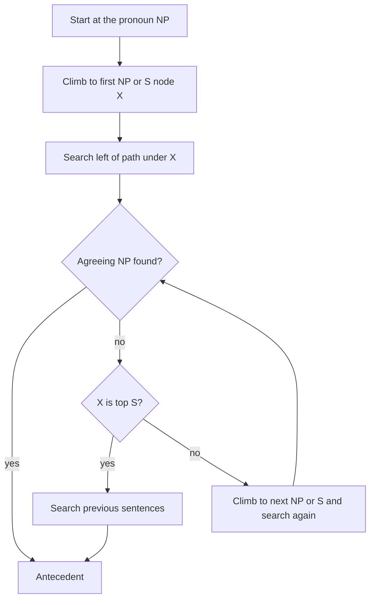

**In simple words:** **anaphora resolution** finds which earlier phrase (the antecedent) a pronoun like *she* or *it* points to. Hobbs does it by searching the parse trees. Centering does it by keeping the topic of the discourse smooth. <Cite id="anaphora-resolution-tp-nlp" />

**1) Hobbs' algorithm (1978).** It walks the parse tree of the sentence, then earlier sentences, in a fixed order and accepts the first noun phrase (NP) that agrees with the pronoun in number, gender and person. <Cite id="anaphora-resolution-hobbs1978" />

1. Start at the NP node of the pronoun.
2. Go up to the first NP or S node X.
3. Search below X to the left of the path, left to right, breadth-first. Propose any NP found that has an NP or S between it and X.
4. If X is the top S, search the previous sentences, most recent first, left to right, breadth-first.
5. Otherwise go up to the next NP or S node and repeat the search on the left; if it is an S, also search to the right (not going below NP or S).
6. The first NP that agrees is the antecedent.

<Cite id="anaphora-resolution-hobbs1978" loc="diagram" />

**2) Centering algorithm.** Based on Grosz, Joshi and Weinstein (1995). Terms for utterance $U_n$: **Cf** = entities mentioned, ranked subject, object, others; **Cp** = top of Cf; **Cb** = highest-ranked entity of the previous Cf that appears again. <Cite id="discourse-reference-grosz1995" />

| | Cb = Cp | Cb ≠ Cp |
|---|---|---|
| Cb same as before | Continue | Retain |
| Cb changed | Smooth-shift | Rough-shift |

Steps (Brennan, Friedman, Pollard 1987): (1) generate possible antecedent choices; (2) filter by agreement and binding; (3) rank by transition, **Continue > Retain > Smooth-shift > Rough-shift**, and take the best. <Cite id="anaphora-resolution-bfp1987" />

**Example.** *Priya met Anita. She gave her a book.* Reading "She = Priya, her = Anita" keeps Priya as topic (Continue); the opposite reading is a Retain. So Priya is chosen.

| Point | Hobbs | Centering |
|---|---|---|
| Based on | Syntax tree search | Salience and coherence |
| Needs | Full parse trees | Entities and grammatical roles |
| Limit | Parse errors, no meaning | Language-dependent ranking |

**Conclusion:** Hobbs finds the nearest agreeing NP by tree walk; centering picks the reading that keeps the topic steady. The two are often used together.
