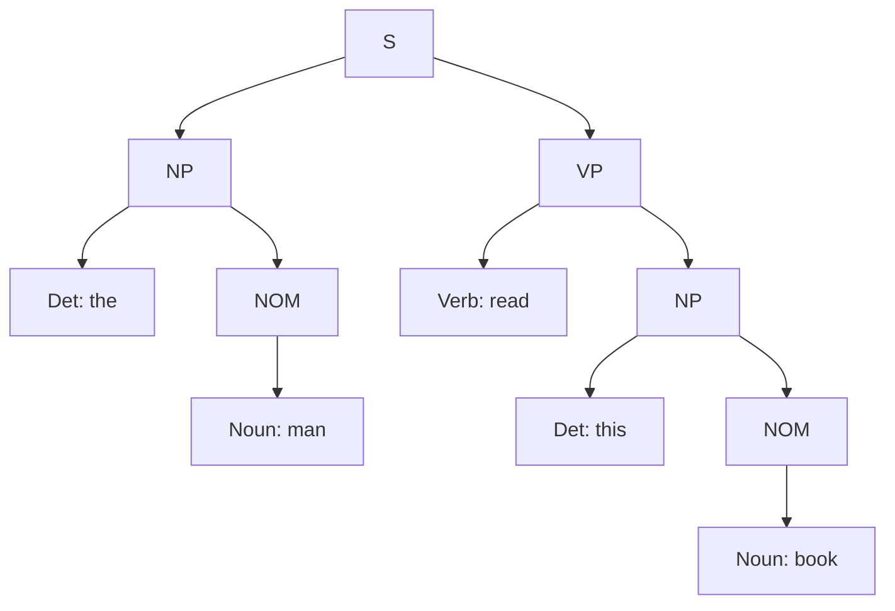

**In simple words:** CYK (Cocke-Younger-Kasami) ek bottom-up table-filling parser hai. Ise grammar **Chomsky normal form (CNF)** mein chahiye, jahan har rule $A \rightarrow B\,C$ ya $A \rightarrow word$ hota hai. Ye sentence ke saare spans ka table bharta hai, sabse chhote pehle. <Cite id="cfg-parsing-gfg-cyk" /> <Cite id="cfg-parsing-wiki-cyk" /> <Cite id="cfg-parsing-slp3-19" loc="§19.4" />

<Sum>

<Given>

Question ka grammar aur sentence *the man read this book* (words 1 se 5).

</Given>

<Find>

sentence accept hota hai ya nahi, aur uska parse tree.

</Find>

<Steps>

1. **CNF mein badlo.** `S → Aux NP VP` ko `S → X1 VP` aur `X1 → Aux NP` mein todo. Unit rules (right side mein ek hi symbol) hatao: `NOM → Noun` ban jaata hai `NOM → book | flight | meal | man`; `VP → Verb` ban jaata hai `VP → book | include | read`; `S → VP` ban jaata hai `S → Verb NP` plus `S → book | include | read`. *Reason: CYK mein right side par sirf do symbols ya ek word allowed hai.*

   CNF rules: `S → NP VP | X1 VP | Verb NP | book | include | read`; `X1 → Aux NP`; `NP → Det NOM`; `NOM → Noun NOM | book | flight | meal | man`; `VP → Verb NP | book | include | read`; plus lexicon.

2. **Length 1** (ek-ek word): *the* = Det; *man* = Noun, NOM; *read* = Verb, VP, S; *this* = Det; *book* = Noun, Verb, NOM, VP, S. *Reason: har word ko lexicon aur CNF word rules mein dhundo.*
3. **Length 2:** *the man* = Det + NOM se **NP**. *man read*: koi rule nahi. *read this*: koi rule nahi. *this book* = Det + NOM se **NP**.
4. **Length 3:** *the man read* = NP + VP se **S**. *man read this*: none. *read this book* = Verb + NP se **VP, S**.
5. **Length 4:** *the man read this*: none. *man read this book*: none.
6. **Length 5:** *the man read this book*: word 2 ke baad split = NP (the man) + VP (read this book) se **S**.

| Span | 1 the | 2 man | 3 read | 4 this | 5 book |
|---|---|---|---|---|---|
| length 1 | Det | Noun, NOM | Verb, VP, S | Det | Noun, Verb, NOM, VP, S |
| length 2 | NP | none | none | NP | |
| length 3 | S | none | S, VP | | |
| length 4 | none | none | | | |
| length 5 | **S** | | | | |

(Cell us word ke neeche likha hai jahan se span shuru hota hai.)

</Steps>

<Answer>

Top cell mein S hai, to sentence **accepted** hai. Parse tree: [S [NP [Det the] [NOM [Noun man]]] [VP [Verb read] [NP [Det this] [NOM [Noun book]]]]].

</Answer>

<Box kind="verify">

Top-down se check: S → NP VP; NP → Det NOM → the man; VP → Verb NP → read, phir NP → Det NOM → this book. Ye saare rules grammar mein hain aur theek paanch words order mein dete hain. Table mein cell (1,5) NP (1,2) aur VP (3,5) se bana, wahi split.

</Box>

</Sum>

<Cite id="cfg-parsing-gfg-cyk" loc="diagram" />

**Complexity:** $n$ words ke liye $O(n^3 \cdot |G|)$ time. **Advantage:** saare parses milte hain. **Disadvantage:** CNF chahiye.

**Conclusion:** sentence grammatical hai, kyunki CYK table ke top cell mein S aaya.

Exam mein English mein likho: "CYK fills a table of spans bottom-up; the sentence is accepted if S is in the top cell."
