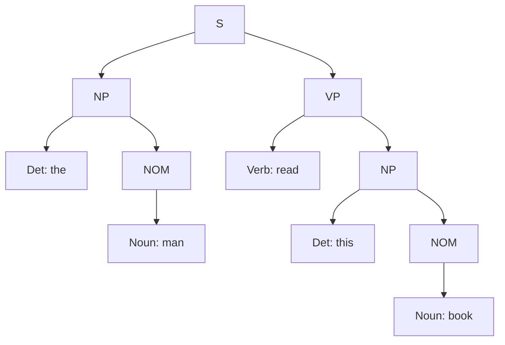

**In simple words:** CYK (Cocke-Younger-Kasami) is a bottom-up table-filling parser. It needs the grammar in **Chomsky normal form (CNF)**, where each rule is $A \rightarrow B\,C$ or $A \rightarrow word$. It fills a table of all spans of the sentence, shortest first. <Cite id="cfg-parsing-gfg-cyk" /> <Cite id="cfg-parsing-wiki-cyk" /> <Cite id="cfg-parsing-slp3-19" loc="§19.4" />

<Sum>

<Given>

The grammar in the question and the sentence *the man read this book* (words 1 to 5).

</Given>

<Find>

whether the sentence is accepted, and its parse tree.

</Find>

<Steps>

1. **Convert to CNF.** Split `S → Aux NP VP` into `S → X1 VP` and `X1 → Aux NP`. Remove the unit rules (one symbol on the right): `NOM → Noun` becomes `NOM → book | flight | meal | man`; `VP → Verb` becomes `VP → book | include | read`; `S → VP` becomes `S → Verb NP` plus `S → book | include | read`. *Reason: CYK allows only two symbols or one word on the right.*

   CNF rules: `S → NP VP | X1 VP | Verb NP | book | include | read`; `X1 → Aux NP`; `NP → Det NOM`; `NOM → Noun NOM | book | flight | meal | man`; `VP → Verb NP | book | include | read`; plus the lexicon.

2. **Length 1** (one word each): *the* = Det; *man* = Noun, NOM; *read* = Verb, VP, S; *this* = Det; *book* = Noun, Verb, NOM, VP, S. *Reason: look each word up in the lexicon and the CNF word rules.*
3. **Length 2:** *the man* = Det + NOM gives **NP**. *man read*: no rule. *read this*: no rule. *this book* = Det + NOM gives **NP**.
4. **Length 3:** *the man read* = NP + VP gives **S**. *man read this*: none. *read this book* = Verb + NP gives **VP, S**.
5. **Length 4:** *the man read this*: none. *man read this book*: none.
6. **Length 5:** *the man read this book*: split after word 2 = NP (the man) + VP (read this book) gives **S**.

| Span | 1 the | 2 man | 3 read | 4 this | 5 book |
|---|---|---|---|---|---|
| length 1 | Det | Noun, NOM | Verb, VP, S | Det | Noun, Verb, NOM, VP, S |
| length 2 | NP | none | none | NP | |
| length 3 | S | none | S, VP | | |
| length 4 | none | none | | | |
| length 5 | **S** | | | | |

(A cell is listed under the word where its span starts.)

</Steps>

<Answer>

S is in the top cell, so the sentence is **accepted**. Parse tree: [S [NP [Det the] [NOM [Noun man]]] [VP [Verb read] [NP [Det this] [NOM [Noun book]]]]].

</Answer>

<Box kind="verify">

Check by top-down: S → NP VP; NP → Det NOM → the man; VP → Verb NP → read, then NP → Det NOM → this book. These rules are all in the grammar and give exactly the five words in order. In the table, the entry in cell (1,5) came from NP (1,2) and VP (3,5), the same split.

</Box>

</Sum>

<Cite id="cfg-parsing-gfg-cyk" loc="diagram" />

**Complexity:** $O(n^3 \cdot |G|)$ time for $n$ words. **Advantage:** finds all parses. **Disadvantage:** needs CNF.

**Conclusion:** the sentence is grammatical, since S fills the top cell of the CYK table.
